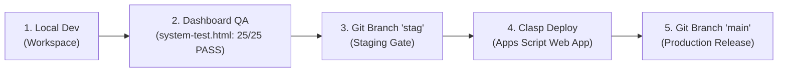

/* ==========================================================================
   FILE: ROADMAP.md - PHẦN [1/3]
   BẮT ĐẦU TỪ: TIÊU ĐỀ & KIẾN TRÚC TỔNG THỂ HỆ SINH THÁI ANNGONLONGHOA.COM.VN
   KẾT THÚC TẠI: KẾT THÚC PHASE 2 - BƯỚC [P2.S2] (CHUẨN HÓA ADMIN-SHELL.HTML)
   HƯỚNG DẪN: Tạo mới hoặc mở file ROADMAP.md tại thư mục gốc và dán toàn bộ Phần 1 này vào đầu file.
   ========================================================================== */

# 🗺️ MASTER ROADMAP: HỆ SINH THÁI ANNGONLONGHOA.COM.VN & LONGHOAFOOD SAAS v3.5
> **Chủ đầu tư & Super Master:** Anh Hải Âu  
> **Cố vấn Chiến lược & Kiến trúc sư Hệ thống:** Đu Đủ  
> **Bản mẫu chuẩn (Gold Master Tenant):** Mì Trộn Thím 5 (Long Hoa, Tây Ninh)  
> **Mô hình Kiến trúc:** Federated Hub-and-Spoke (1 Cổng Cộng Đồng Trung Tâm + N Gian Hàng Web D2C Độc Lập)

---

## I. ĐỊNH NGHĨA 4 ĐỐI TƯỢNG CỐT LÕI & CÔNG THỨC TÀI CHÍNH ĐỘNG (DYNAMIC CONFIG)

Toàn bộ tham số tài chính dưới đây **TUYỆT ĐỐI KHÔNG HARD-CODE** trong mã nguồn mà bắt buộc đọc động từ Sheet `SYS_CONFIG` thông qua `ConfigManager.gs` (có `CacheService` < 150ms):

### 1. ĐỐI TƯỢNG 1: SUPER MASTER (Anh Hải Âu - Chủ Sàn Liên Minh `anngonlonghoa.com.vn`)
* **Triết lý thu phí:** *Zero Fixed Cost (Pay-as-you-sell)* — Quán không tốn phí duy trì cố định hàng tháng, chỉ trích phí khi phát sinh đơn hàng thực tế.
* **Nguồn thu 1 - Phí Nền Tảng Đơn Hàng D2C (`MASTER_PLATFORM_FEE_PCT`):**
  - Mặc định: `5%` tính trên doanh thu đơn hàng sau giảm giá.
  - Công thức: `Master_Order_Fee = Order_Net_Subtotal * (MASTER_PLATFORM_FEE_PCT / 100)`.
* **Nguồn thu 2 - Chênh Lệch Điều Phối Ship Động Theo Km (`DYNAMIC_SHIP_SPREAD`):**
  - Biến cấu hình trong `SYS_CONFIG`:
    + `SHIP_CUST_RATE_PER_KM`: Giá thu khách mỗi km (Mặc định: `5000` VNĐ/km).
    + `SHIP_PARTNER_RATE_PER_KM`: Giá trả Shipper mỗi km (Mặc định: `4500` VNĐ/km).
    + `SHIP_BASE_FEE_CUST`: Giá mở cửa thu khách (Mặc định: `0` hoặc cấu hình theo chặng).
    + `SHIP_SURGE_MULTIPLIER`: Hệ số nhân giờ cao điểm / mưa bão (Mặc định: `1.0`, mưa lớn: `1.2` - `1.5`).
  - Công thức chênh lệch thu về Sổ cái Super Master:
    `Master_Ship_Spread = (Distance_Km * SHIP_CUST_RATE_PER_KM * SHIP_SURGE_MULTIPLIER) - (Distance_Km * SHIP_PARTNER_RATE_PER_KM * SHIP_SURGE_MULTIPLIER)`.
* **Nguồn thu 3 - Đấu Giá Vị Trí Vàng Theo Kết Quả (`CPA_SPOTLIGHT_BOOST_PCT`):**
  - Bài viết/Gian hàng được ghim Top Cộng Đồng `anngonlonghoa.com.vn`: Không thu phí treo bảng. Nếu đơn hàng phát sinh từ nguồn `utm_source=community_spotlight`, thu thêm `+3%` (Tổng `8%`).
* **Nguồn thu 4 - Bán Chéo Liên Gian Hàng (`CROSS_STORE_AFFILIATE_PCT`):**
  - Gợi ý ghép Nước uống / Topping (Food Cost <= 20%) từ quán liên minh nằm cùng trục đường giao hàng, thu hoa hồng giới thiệu `10%` trên món ghép.
* **Quyền hạn tối cao (`SUPER_ADMIN_LV3` - 2FA TOTP):** Kiểm duyệt bài đăng Cộng đồng của các Chủ quán, quản trị tham số toàn cục, khởi tạo (Clone) gian hàng mới bằng 1 chạm.

### 2. ĐỐI TƯỢNG 2: CHỦ QUÁN / TENANT (Quán F&B tại Long Hoa - Mẫu chuẩn: Mì Trộn Thím 5)
* **Vận hành Web D2C riêng:** Tối ưu biên lợi nhuận ròng cao hơn hẳn kênh App (Grab/Shopee thu 25%-30%).
* **Quản trị Thực đơn 13 cột Reverse-Pricing (`DATA_MENU`):**
  - Công thức: `Giá Niêm Yết = (Food Cost Mục Tiêu + Lợi Nhuận Ròng) / (1 - % Tổng Khấu Trừ Nền Tảng)`.
* **Ràng buộc Biên Food Cost theo Danh mục (`SYS_CATEGORIES`):**
  - `TRAFFIC` (Món mồi kéo khách): Food Cost `50% - 55%` (Trần cảnh báo đỏ: `55%`).
  - `CORE` (Món chủ lực): Food Cost `35% - 45%` (Trần cảnh báo đỏ: `45%`).
  - `BOOSTER` (Nước uống / Topping kéo AOV): Food Cost `<= 20%` (Trần cảnh báo đỏ: `20%`).
* **Đăng bài Cộng đồng & Remarketing:** Chủ quán tạo bài viết giới thiệu món/khuyến mãi ngay trên `admin-shell.html` -> Trạng thái `PENDING_APPROVAL` chờ anh Hải Âu duyệt -> Khi duyệt tự động gắn link đặt món trỏ thẳng về Web D2C của quán.
* **Phân quyền nội bộ quán:**
  - `KITCHEN_LV1` (PIN `1985`): Chỉ xem màn hình bếp KDS và bật/tắt hết món.
  - `POS_LV2` (PIN `2026`): Thu ngân, tạo đơn tại quầy, điều phối Shipper, đối soát COD.
  - `TENANT_ADMIN` (2FA/Password): Quản lý thực đơn, xem P&L của quán, đăng bài Cộng đồng.

### 3. ĐỐI TƯỢNG 3: KHÁCH HÀNG (Thực Khách Khu Vực Long Hoa – Tây Ninh)
* **Trải nghiệm Đặt món D2C độc quyền:**
  - Đòn bẩy kéo AOV >= `79.000đ` (Mục tiêu `70.000đ - 100.000đ`) thông qua Combo Đại Tiệc (`99k - 150k`), Vòng quay may mắn (Gamification), Mini CRM tích điểm thăng hạng VIP (`DATA_CUSTOMERS`), chính sách No Free Soup.
  - Khóa trần tổng khuyến mãi toàn đơn `<= 15%` doanh thu gộp (`MAX_PROMO_CAP_PCT = 15`) để không bao giờ âm dòng tiền ngầm.
  - Thanh toán VietQR động khóa cứng số tiền & nội dung chuyển khoản; Order Auto-Confirm cho khách VIP; Live Tracking 5 bước.
* **Lá Chắn Đánh Giá Xác Thực Chống Chơi Xấu (`VERIFIED_REVIEW_GATE`):**
  - **CẤM TUYỆT ĐỐI bình luận hoặc chấm sao ẩn danh.**
  - Khách hàng chỉ gửi được đánh giá khi hệ thống đối soát khớp đồng thời: `Customer_Phone` + `Order_ID` có trạng thái `COMPLETED` (Đã giao thành công) trong Sheet `DATA_ORDERS`. Mỗi `Order_ID` chỉ được đánh giá đúng 1 lần duy nhất.

### 4. ĐỐI TƯỢNG 4: SHIPPER (Hệ Thống Giao Hàng Lai Ghép - Hybrid Fleet Engine)
* **Tầng 1 - Đội Shipper Nội Bộ (`INTERNAL_FLEET`):**
  - Quy tắc "Tiền trao cháo múc" tại bếp.
  - Khóa cứng trần nợ tạm COD Shipper `<= 300.000đ` (`COD_HOLDING_LIMIT = 300000` đọc động từ `SYS_CONFIG`). Nếu công nợ hiện tại trong `DATA_SHIPPER_LEDGER` vượt trần 300k, hệ thống tự động chặn gán đơn mới cho đến khi tất toán công nợ qua API `settleShipperDebt`.
* **Tầng 2 - Kênh Đối Tác Ngoại Vi (`3PL_PARTNER`: GrabExpress / Vill / Xanh SM):**
  - Khi quá tải hoặc đơn xa, Thu ngân/Bếp bấm chuyển chế độ gọi Ship đối tác (1-Click Copy lộ trình chuẩn hóa & ghi nhận trạng thái `DISPATCHED_3PL`), hệ thống vẫn hạch toán đủ `5%` phí nền tảng đơn hàng cho Super Master.

---

## II. QUY TẮC ĐIỀU PHỐI AI AGENT & CHẾ ĐỘ ĐA MÀN HÌNH CHAT (CONCURRENCY GOVERNANCE)

### 1. Phân Vai Model AI Chuẩn Tối Ưu Quota
1. **Lập Kế Hoạch & Kiểm Toán (`/plan`):** Dùng **Cửa sổ Chat Cố vấn Đu Đủ** hoặc **`Claude Opus 4.6 (Thinking)` / `Claude Sonnet 4.6 (Thinking)`** (Chỉ dùng khi cần phân tích sâu kiến trúc liên file).
2. **Thực Thi Viết Mã Nguồn (`/goal`):** Dùng **`Gemini 3.8 Flash High`** (hoặc model cao hơn khi sẵn sàng). Bắt buộc kẹp danh sách `@file` trong mục **Mandatory File Mapping** của từng bước dưới đây để chống mù ngữ cảnh và tự động kích hoạt `[PROMPT-02] CHUNKING_EXPORTER` trong `PROMPT_REGISTRY.md`.

### 2. Quy Tắc Mở Nhiều Màn Hình Chat Cùng Lúc (Fork-Join Pattern)
* 🔒 **`[ĐƠN LUỒNG - CHỈ 1 MÀN HÌNH CHAT]`:** Áp dụng bắt buộc cho **Phase 1, Phase 2 và Phase 6** (vì chạm vào các file dùng chung toàn cục: `thim5-master-dictionary.js`, `MasterDictionary.gs`, `CoreRouter.gs`, `ConfigManager.gs`, `admin-shell.html`). **Tuyệt đối không mở 2 chat sửa cùng lúc các file này!**
* ⚡ **`[SONG SONG OK - TỐI ĐA 3 MÀN HÌNH CHAT CÔ LẬP]`:** Áp dụng cho **Phase 3, Phase 4 và Phase 5** sau khi Phase 1 & 2 đã hoàn tất. Mỗi màn hình chat chỉ phụ trách đúng 1 **Pod tính năng độc lập (Feature Pod)** không trùng file với màn hình chat khác.
* ⚠️ **Nguyên tắc Clasp Push:** Chỉ chạy lệnh `npx @google/clasp push` ở Terminal khi tất cả các màn hình chat đang mở đã hoàn tất việc ghi file `.gs` (không có file nào đang sửa dở dang).

---

## III. CHI TIẾT TỪNG BƯỚC THỰC THI (6 PHASES - 14 ATOMIC STEPS)

---

### 🟢 PHASE 1: KHÓA CỨNG HIẾN PHÁP & ĐỒNG BỘ TỪ ĐIỂN SSOT 2 ĐẦU
> **Chế độ chạy:** 🔒 `[ĐƠN LUỒNG - CHỈ 1 MÀN HÌNH CHAT]`  
> **Mục tiêu:** Làm sạch kho chứa và khóa cứng toàn bộ tên Sheet, tên Cột, tên Action API, hằng số cấu hình động vào Từ điển chuẩn trước khi chạm vào bất kỳ file giao diện hay nghiệp vụ nào.

#### 🔹 BƯỚC `[P1.S1]`: Dọn Rác Lịch Sử AI Cũ & Khởi Tạo Bộ 3 Tệp Điều Phối Trung Tâm
* **1. Trạng thái:** `[x] Hoàn tất` | 🔒 `[ĐƠN LUỒNG - 1 CHAT]`
* **2. Mục tiêu chức năng:**
  - Xóa bỏ các file lịch sử gây nhiễu công cụ tìm kiếm của Agent (`.aider.chat.history.md`, `.aider.input.history`, `.clinerules`, `.roorules`).
  - Đảm bảo 3 tệp quản trị cốt lõi tồn tại chuẩn xác tại thư mục gốc: `.antigravity/rules.md`, `PROMPT_REGISTRY.md`, và `ROADMAP.md`.
* **3. Bản đồ Ánh xạ File bắt buộc (Mandatory File Mapping):**
  - `/.antigravity/rules.md`
  - `/PROMPT_REGISTRY.md`
  - `/ROADMAP.md`
  - `/.gitignore` (Bảo vệ tuyệt đối `.clasp*.json` và các file `.md` nội bộ).
* **4. Tiêu chuẩn Nghiệm thu (Definition of Done - DoD):**
  - Thư mục gốc sạch sẽ, các tệp quản trị hệ thống sẵn sàng.

#### 🔹 BƯỚC `[P1.S2]`: Đồng Bộ Từ Điển SSOT 2 Đầu & Bổ Sung Hằng Số Hệ Sinh Thái v3.5
* **1. Trạng thái:** `[x] Hoàn tất` | 🔒 `[ĐƠN LUỒNG - 1 CHAT]`
* **2. Mục tiêu chức năng & Nghiệp vụ F&B:**
  - Đồng bộ 100% danh mục `ACTIONS` (API Contract), `SHEETS` (7 Sheet SSOT), `ORDERS_SCHEMA` (17 cột), `MENU_SCHEMA` (13 cột), `CATEGORIES_SCHEMA` (5 cột), `ROLES`, `ERROR_CODES`, `CONFIG_KEYS` giữa `FRONTEND_WEB/thim5-master-dictionary.js` và `BACKEND_APPSCRIPT/MasterDictionary.gs`.
  - Bổ sung bộ hằng số tài chính Hệ sinh thái AnNgonLongHoa.com.vn v3.5: Phí sàn Super Master 5%, Biểu phí ship động 5k thu khách / 4.5k trả tài xế (chênh lệch 500đ/km về Sàn), Hệ số Surge Multiplier, Phí CPA Spotlight +3%, Bán chéo Affiliate 10%, Trần Food Cost 3 tầng (Traffic 55% / Core 45% / Booster 20%), Khóa nợ tạm COD 300k, Lá chắn review xác thực qua `Order_ID`.
  - Bổ sung hệ thống Alias 2 chiều giúp triệt tiêu hoàn toàn nguy cơ lệch Action string (`uploadDishMediaImage`, `toggleStoreOperationalStatus`,...).
* **3. Bản đồ Ánh xạ File bắt buộc (Mandatory File Mapping):**
  - `@FRONTEND_WEB/thim5-master-dictionary.js`
  - `@BACKEND_APPSCRIPT/MasterDictionary.gs`
  - `@.antigravity/rules.md`
  - `@PROMPT_REGISTRY.md`
* **4. Tiêu chuẩn Nghiệm thu (Definition of Done - DoD):**
  - Cả 2 file từ điển đều vượt qua kiểm tra cú pháp không lỗi (`node -c` Clean 100%).
  - Tích hợp hàm `getSystemContract` tự động bơm runtime hydration đầy đủ schemas, categories, roles về Client.
  - Hàm `syncDatabaseSchema` tự động tạo Header an toàn cho `SYS_CATEGORIES` và `SYS_CONFIG`.

---

### 🟡 PHASE 2: HOÀN THIỆN TRỤC XƯƠNG SỐNG HỆ THỐNG (BACKBONE ENGINE & RBAC GATEWAY)
> **Chế độ chạy:** 🔒 `[ĐƠN LUỒNG - CHỈ 1 MÀN HÌNH CHAT]`  
> **Điều kiện tiên quyết:** Đã hoàn thành Phase 1.  
> **Mục tiêu:** Tối ưu hóa hiệu năng phản hồi < 150ms với CacheService, khóa cứng các chốt chặn tài chính và bảo đảm an ninh RBAC đa tầng.

#### 🔹 BƯỚC `[P2.S1]`: Tối Ưu Hóa CacheService (< 150ms), Cấu Hình Tài Chính Động & Nâng Cấp CoreRouter.gs
* **1. Trạng thái:** `[x] Hoàn tất` | 🔒 `[ĐƠN LUỒNG - 1 CHAT]`
* **2. Mục tiêu chức năng & Nghiệp vụ F&B:**
  - Áp dụng `CacheService` cho `SYS_CONFIG` và `SYS_CATEGORIES` trong `ConfigManager.gs` để phản hồi < 150ms, kèm hàm `invalidateAllConfigCache()` xóa sạch cache khi lưu cấu hình hoặc toggle trạng thái quán.
  - Bổ sung helper nghiệp vụ F&B:
    + `getMasterPlatformFeeConfig()`: Phí sàn Master 5%, CPA Spotlight +3%, Affiliate 10%.
    + `calculateDynamicShipRates()`: Biểu phí ship động 5.000đ/km khách, 4.500đ/km shipper, tính chênh lệch `masterMarginSpread` theo khoảng cách và hệ số nhân cao điểm `surgeMultiplier`.
    + `getFinancialGuardrails()`: Khóa trần công nợ COD 300.000đ, trần khuyến mãi 15%, trần Food Cost 3 tầng (Traffic 55%, Core 45%, Booster 20%).
    + `getCachedCategories()`: Đọc danh mục kèm trần Food Cost có đệm CacheService.
  - Nâng cấp `CoreRouter.gs`:
    + Bảo toàn 100% routes hiện hữu và Fast-track Shipper.
    + Bổ sung toàn bộ routes/aliases từ `MasterDictionary.gs` và Phase 5 (`submitCommunityPost`, `approveCommunityPost`, `getCommunityFeed`, `submitVerifiedReview`, `getVerifiedReviews`).
    + Cập nhật tường lửa RBAC: `approveCommunityPost` và `invalidateAllConfigCache` yêu cầu Master Key / 2FA; nhận diện vai trò `SUPER_ADMIN_LV3`, `TENANT_ADMIN`, `POS_LV2`.
* **3. Bản đồ Ánh xạ File bắt buộc (Mandatory File Mapping):**
  - `@BACKEND_APPSCRIPT/ConfigManager.gs`
  - `@BACKEND_APPSCRIPT/CoreRouter.gs`
  - `@BACKEND_APPSCRIPT/MasterDictionary.gs`
  - `@FRONTEND_WEB/thim5-master-dictionary.js`
* **4. Tiêu chuẩn Nghiệm thu (Definition of Done - DoD):**
  - Cả 2 file `.gs` vượt qua kiểm tra cú pháp V8 JavaScript (`node -c` không lỗi).
  - Không sử dụng bất kỳ placeholder nào (tuân thủ `[PROMPT-02] CHUNKING_EXPORTER`).

#### 🔹 BƯỚC `[P2.S2]`: Khóa Cứng RBAC 3 Cấp & Phân Quyền Super Master Tại `admin-shell.html`
* **1. Trạng thái:** `[x] Hoàn tất` | 🔒 `[ĐƠN LUỒNG - 1 CHAT]`
* **2. Mục tiêu chức năng & Nghiệp vụ F&B:**
  - Nâng cấp giao diện quản trị `admin-shell.html` hỗ trợ 3 cấp quyền chuẩn SSOT: `KITCHEN_LV1` (PIN 1985), `POS_LV2` (PIN 2026), `TENANT_ADMIN`, và `SUPER_ADMIN_LV3` (2FA TOTP Google Authenticator).
  - Khóa chặt phân hệ Cấu Hình Toàn Hệ Thống (`tab-config.html`) và Trung Tâm Chiến Dịch chỉ dành riêng cho Super Admin (`SUPER_ADMIN` / `SUPER_ADMIN_LV3`).
  - Tích hợp nạp động module Thực Đơn (`tab-menu.html`) qua SPA Router và nhúng trực tiếp `tab-menu.js`, tự động kích hoạt `TabMenuController.init()` ngay khi chuyển tab.
  - Bảo toàn 100% cơ chế in-memory `tabCache`, công tắc mở/đóng cửa bếp thời gian thực (`AdminStoreControl`), và giám sát nhịp tim mạng GAS (`runSystemHeartbeat`).
* **3. Bản đồ Ánh xạ File bắt buộc (Mandatory File Mapping):**
  - `@FRONTEND_WEB/admin-shell.html`
  - `@FRONTEND_WEB/tab-menu.js`
  - `@FRONTEND_WEB/thim5-master-dictionary.js`
  - `@BACKEND_APPSCRIPT/ConfigManager.gs`
* **4. Tiêu chuẩn Nghiệm thu (Definition of Done - DoD):**
  - Đăng nhập đúng cấp bậc hiển thị đúng quyền hạn giao diện.
  - `TabMenuController.init()` được kích hoạt chuẩn xác khi chuyển sang tab 'menu'.
  - Toàn bộ inline scripts và `tab-menu.js` vượt qua kiểm tra cú pháp không lỗi (`node -c`).

---

### 🟠 PHASE 3: XỬ LÝ DỨT ĐIỂM MODULE THỰC ĐƠN & ĐỊNH GIÁ ĐỘNG REVERSE-PRICING (POD A)
> **Chế độ chạy:** ⚡ `[SONG SONG OK - MÀN HÌNH CHAT 1 (POD THỰC ĐƠN)]`  
> **Điều kiện tiên quyết:** Đã hoàn thành Phase 1 và Phase 2.  
> **Mục tiêu:** Giải quyết triệt để 4 lỗi Critical đã phát hiện (lỗi hardcode 20% trong `CatalogService.gs`, 30+ DOM ID lệch giữa `tab-menu.html` và `tab-menu.js`, thiếu cột trong 13 cột `DATA_MENU`, kích hoạt công thức Reverse-Pricing 4 chiều và cảnh báo biên Food Cost theo danh mục).

#### 🔹 BƯỚC `[P3.S1]`: Xóa Bỏ Hard-Code 20% & Chuẩn Hóa 13 Cột `DATA_MENU` Tại `CatalogService.gs`
* **1. Trạng thái:** `[x] Hoàn tất` | ⚡ `[SONG SONG OK - POD A]`
* **2. Mục tiêu chức năng & Nghiệp vụ F&B:**
  - Tại `BACKEND_APPSCRIPT/CatalogService.gs` (cả hàm `batchImportMenuItems`, `saveOrUpdateMenuItem` và `fetchAllMenuItemsFromSheet_`): Đã loại bỏ hoàn toàn lệnh gán cứng `var discountPercent = 20` và hệ số nhân `1.25`.
  - Tích hợp hàm helper `getDefaultD2cDiscount_()` đọc cấu hình động `% Giảm D2C` từ `SYS_CONFIG` thông qua `ConfigManager.gs` (có đệm RAM CacheService < 150ms), fallback an toàn = 20.
  - Áp dụng công thức Reverse-Pricing 4 chiều động: Tính chuẩn Giá App từ Giá D2C và ngược lại theo tỷ lệ chiết khấu thực tế.
  - Khóa cứng và bảo đảm 100% thứ tự **13 cột chuẩn SSOT của `DATA_MENU`**:
    `[0] Mã Món`, `[1] Tên Món Ăn`, `[2] Nhóm Phân Loại`, `[3] Giá App`, `[4] % Giảm D2C`, `[5] Giá Bán D2C Web`, `[6] Giá Vốn COGS`, `[7] Lợi Nhuận Ròng`, `[8] Trạng Thái Bếp`, `[9] Mô Tả`, `[10] Link Ảnh`, `[11] Bán Kèm`, `[12] Tag Chiến Lược`.
  - Khóa cứng và bảo đảm 100% thứ tự **5 cột chuẩn SSOT của `SYS_CATEGORIES`**:
    `[0] Mã Danh Mục`, `[1] Icon`, `[2] Tên Danh Mục`, `[3] Slug D2C`, `[4] Trần Food Cost`.
* **3. Bản đồ Ánh xạ File bắt buộc (Mandatory File Mapping):**
  - `@BACKEND_APPSCRIPT/CatalogService.gs`
  - `@BACKEND_APPSCRIPT/ConfigManager.gs`
  - `@BACKEND_APPSCRIPT/MasterDictionary.gs`
  - `@PROMPT_REGISTRY.md`
* **4. Tiêu chuẩn Nghiệm thu (Definition of Done - DoD):**
  - Không còn bất kỳ vị trí nào hardcode `1.25` hoặc `20` cố định trong `CatalogService.gs`.
  - Kiểm tra cú pháp V8 Engine (`node -c`) vượt qua 100% không lỗi.
  - Cơ chế CacheService tự động làm sạch `T5_CATALOG_BUNDLED_CACHE` và `WARMED_MENU_CATALOG` khi thêm/sửa/xóa món.

#### 🔹 BƯỚC `[P3.S2]`: Chuẩn Hóa `FRONTEND_WEB/tab-menu.html` Khớp 100% 56 DOM ID với `tab-menu.js`, Đủ 13 Cột Table Header & Live Reverse-Pricing 4 Chiều
* **1. Trạng thái:** `[x] Hoàn tất` | ⚡ `[SONG SONG OK - POD A]`
* **2. Mục tiêu chức năng & Nghiệp vụ F&B:**
  - Viết lại và đồng bộ 100% 56 DOM ID được truy vấn bởi `tab-menu.js` (không còn lệch tên cũ như `#dish-code`, `#dish-price`).
  - Đảm bảo đầy đủ 13 cột Table Header ma trận Thực đơn Reverse-Pricing, khớp điều kiện kiểm tra `thead.querySelectorAll("th").length === 13`.
  - Bổ sung ô nhập `% Giảm Web D2C` (`#modalDishDiscountPercent`) trong Form Modal 13 cột và kích hoạt tính toán tài chính Live 4 chiều (App Price, % Discount, Web D2C, COGS).
  - Tích hợp cảnh báo vượt trần Food Cost theo danh mục (`#modalDishFcWarningBox`), tính lợi nhuận ròng (`#modalDishProfitDisplay`).
  - Loại bỏ hoàn toàn hệ số nhân cứng `1.25` và `20` trong `tab-menu.js`, chuyển sang helper động `getDefaultDiscountPercent_()`.
  - Bổ sung chốt chặn phòng vệ `dataset.bound` cho các event listeners trong `tab-menu.js` để ngăn chặn việc gắn trùng lặp sự kiện khi SPA re-init.
* **3. Bản đồ Ánh xạ File bắt buộc (Mandatory File Mapping):**
  - `@FRONTEND_WEB/tab-menu.html`
  - `@FRONTEND_WEB/tab-menu.js`
  - `@FRONTEND_WEB/admin-shell.html`
  - `@FRONTEND_WEB/thim5-master-dictionary.js`
* **4. Tiêu chuẩn Nghiệm thu (Definition of Done - DoD):**
  - Khớp 100% 56 DOM ID giữa `tab-menu.html` và `tab-menu.js`.
  - Bảng thực đơn chính hiển thị đúng 13 cột Header & Body chuẩn SSOT `DATA_MENU`.
  - Đầy đủ 21 hàm Public API xuất bản trên `window.TabMenuController`.
  - Cả 2 file vượt qua kiểm tra cú pháp V8 JavaScript (`node -c`) với 0 lỗi.

#### 🔹 BƯỚC `[P3.S3]`: Hoàn Thiện `FRONTEND_WEB/tab-menu.js`, Khử Trùng Lặp Upload Ảnh, Đồng Bộ 13 Cột Reverse-Pricing & Xóa Bỏ Hardcode 20%
* **1. Trạng thái:** `[x] Hoàn tất` | ⚡ `[SONG SONG OK - POD A]`
* **2. Mục tiêu chức năng & Nghiệp vụ F&B:**
  - Khử trùng lặp triệt để hàm `handleDishImageUpload(event)` thành một phiên bản chuẩn tắc duy nhất tích hợp nén ảnh Canvas Client-side (< 150KB WebP/JPEG), xem trước tức thì và upload trực tiếp lên Drive CDN qua Action SSOT.
  - Xóa bỏ 100% hardcode `20%` trong form nhập liệu món ăn mới và chế độ chỉnh sửa, đồng bộ qua helper động `getDefaultDiscountPercent_()` đối chiếu `window.T5_DICT.CONFIG.FALLBACK_D2C_DISCOUNT_PERCENT`.
  - Đồng bộ 100% 56 DOM ID đối chiếu với `FRONTEND_WEB/tab-menu.html` và đảm bảo an toàn sự kiện SPA qua chốt chặn `dataset.bound`.
  - Xuất bản đầy đủ 21 hàm Public API trên `window.TabMenuController`, sẵn sàng cho SPA router tại `admin-shell.html`.
* **3. Bản đồ Ánh xạ File bắt buộc (Mandatory File Mapping):**
  - `@FRONTEND_WEB/tab-menu.js`
  - `@FRONTEND_WEB/tab-menu.html`
  - `@FRONTEND_WEB/thim5-master-dictionary.js`
  - `@FRONTEND_WEB/admin-shell.html`
* **4. Tiêu chuẩn Nghiệm thu (Definition of Done - DoD):**
  - Khớp 100% 56 DOM ID và 21 hàm Public API.
  - Không còn bất kỳ vị trí nào hardcode discount 20% hoặc hàm upload ảnh bị khai báo trùng lặp.
  - Vượt qua kiểm tra cú pháp V8 JavaScript (`node -c`) với 0 lỗi.

#### 🔹 BƯỚC `[P3.S4]`: Kiểm Toán & Đồng Bộ `FRONTEND_WEB/menu-manager.html` với `BACKEND_APPSCRIPT/IngestionEngine.gs` & `thim5-master-dictionary.js`
* **1. Trạng thái:** `[x] Hoàn tất` | ⚡ `[SONG SONG OK - POD A]`
* **2. Mục tiêu chức năng & Nghiệp vụ F&B:**
  - Nâng cấp bảng thực đơn chính tại `menu-manager.html` từ 9 cột lên đủ 13 cột Table Header chuẩn SSOT `DATA_MENU` ma trận Reverse-Pricing (`appPrice`, `discountPercent`, `d2cPrice`, `cogs`, `actualFcPercent`, `profit`, `boosterSoup`, `status`,...).
  - Mở rộng cổng RBAC độc lập tại `checkStudioAccess()` hỗ trợ toàn bộ 4 cấp bậc chuẩn SSOT: `SUPER_ADMIN_LV3`, `SUPER_ADMIN`, `TENANT_ADMIN`, `POS_LV2`, `POS_STAFF`, `KITCHEN_LV1`, `KITCHEN_LEAD`.
  - Triệt tiêu hardcode `value="20"` tại ô nhập `% Giảm D2C` (`#modalDishDiscountPercent`), chuyển sang placeholder `10` và nạp động qua `getDefaultDiscountPercent_()`.
  - Bổ sung định danh `id="inputMenuExcelFile"` và `id="inputMenuOcrImage"` cho 2 tệp nạp Omni-Ingestion Pipeline.
  - Đồng bộ `IngestionEngine.gs`:
    + Tích hợp hàm `getDefaultD2cDiscount_()` đọc động `% Giảm D2C` từ `SYS_CONFIG` / `ConfigManager.gs` (fallback 10.0%).
    + Chuẩn hóa hàm nạp ảnh `uploadImageToMenuDriveFolder` và alias `uploadDishMediaImage` hỗ trợ cả `base64` và `base64Data`, trả về đầy đủ các trường link CDN (`imageUrl`, `url`, `viewUrl`, `directCdnUrl`).
    + Hỗ trợ giải mã Base64 cho bộ đệm bảng tính tại `parseUploadedSpreadsheetBuffer`.
    + Đảm bảo cơ chế làm sạch cache `CacheService` và `invalidateAllConfigCache()` sau khi chạy `batchImportMenuItems`.
* **3. Bản đồ Ánh xạ File bắt buộc (Mandatory File Mapping):**
  - `@FRONTEND_WEB/menu-manager.html`
  - `@BACKEND_APPSCRIPT/IngestionEngine.gs`
  - `@FRONTEND_WEB/thim5-master-dictionary.js`
  - `@FRONTEND_WEB/tab-menu.js`
* **4. Tiêu chuẩn Nghiệm thu (Definition of Done - DoD):**
  - Khớp 100% 56 DOM ID và đầy đủ 13 cột Table Header.
  - Cả 2 file (`menu-manager.html` và `IngestionEngine.gs`) vượt qua kiểm tra cú pháp V8 JavaScript (`vm.Script` và `node -c`) với 0 lỗi.

---

### 🔵 PHASE 4: HOÀN THIỆN ĐƠN HÀNG D2C, CÔNG THỨC SHIP ĐỘNG 5K/4.5K, HYBRID SHIPPER & BÁO CÁO P&L TÁCH PHÍ MASTER 5% (POD B)
> **Chế độ chạy:** ⚡ `[SONG SONG OK - MÀN HÌNH CHAT 2 (POD VẬN HÀNH & TÀI CHÍNH)]`  
> **Điều kiện tiên quyết:** Đã hoàn thành Phase 1 và Phase 2.  
> **Mục tiêu:** Xây dựng cỗ máy điều phối Shipper lai ghép (Hybrid Fleet Engine), công thức Ship động theo km tách phí sàn 500đ/km, khóa trần công nợ COD 300.000đ, chốt chặn khuyến mãi toàn đơn <= 15% và Báo cáo P&L dòng tiền chuẩn SSOT.

#### 🔹 BƯỚC `[P4.S1]`: Hybrid Shipper Fleet, Giới Hạn Nợ Tạm COD 300.000đ & Tách 500đ/km Phí Điều Phối Về Sàn
* **1. Trạng thái:** `[x] Hoàn tất` | ⚡ `[SONG SONG OK - POD B]`
* **2. Mục tiêu chức năng & Nghiệp vụ F&B:**
  - **Tầng 1 - Shipper Nội Bộ (`INTERNAL_FLEET`):**
    + Triển khai quy tắc *"Tiền trao cháo múc"* tại quầy bếp.
    + Đọc động trần nợ COD `COD_HOLDING_LIMIT = 300000` từ `SYS_CONFIG`.
    + Kiểm tra công nợ tài xế trong `DATA_SHIPPER_LEDGER`: Nếu nợ tạm vượt trần 300k, tự động khóa nút gán đơn và thông báo tài xế nộp két (`settleShipperDebt`).
    + Chặn tuyệt đối hành vi xóa tài xế khi công nợ chưa về 0.
  - **Tầng 2 - Kênh Đối Tác 3PL (`GrabExpress` / `Vill` / `Xanh SM`):**
    + Khi quán quá tải hoặc đơn khoảng cách xa (> 5km), hỗ trợ nút bấm chuyển đổi 1-Click sang chế độ gọi ship ngoài (`DISPATCHED_3PL`), tự động copy lộ trình giao hàng chuẩn hóa.
  - **Công thức Ship động theo Km:**
    + Áp dụng `calculateDynamicShipRates()`: Thu khách 5.000đ/km, trả shipper 4.500đ/km.
    + Tự động tách chênh lệch `500đ/km * Hệ số cao điểm` ghi nhận về Sổ Cái Master `DATA_MASTER_LEDGER`.
* **3. Bản đồ Ánh xạ File bắt buộc (Mandatory File Mapping):**
  - `@BACKEND_APPSCRIPT/ShipperService.gs`
  - `@BACKEND_APPSCRIPT/ConfigManager.gs`
  - `@FRONTEND_WEB/tab-shippers.html`
  - `@FRONTEND_WEB/thim5-master-dictionary.js`
  - `@BACKEND_APPSCRIPT/MasterDictionary.gs`
* **4. Pha Tư Duy (`/plan`):**
  ```text
  /plan @BACKEND_APPSCRIPT/ShipperService.gs @FRONTEND_WEB/tab-shippers.html @BACKEND_APPSCRIPT/ConfigManager.gs Kiểm toán 11 tiêu chí Zero-Defect cho Bước [P4.S1]: Kiểm tra logic khóa trần nợ COD 300k, công thức chênh lệch ship 5k/4.5k và luồng điều phối Hybrid Shipper nội bộ + 3PL. Không sửa code!
  ```
* **5. Pha Thực Thi (`/goal`):**
  ```text
  /goal Đọc @ROADMAP.md bước [P4.S1] và @PROMPT_REGISTRY.md mục [PROMPT-02] CHUNKING_EXPORTER. Hãy nâng cấp @BACKEND_APPSCRIPT/ShipperService.gs và @FRONTEND_WEB/tab-shippers.html đối chiếu với @FRONTEND_WEB/thim5-master-dictionary.js và @BACKEND_APPSCRIPT/ConfigManager.gs: 1. Áp dụng trần COD 300k động. 2. Tách chênh lệch ship 500đ/km về Sàn. 3. Thêm chế độ chuyển 3PL. Xuất code đầy đủ 100%!
  ```
* **6. Tiêu chuẩn Nghiệm thu (Definition of Done - DoD):**
  - Tài xế có nợ COD > 300.000đ bị chặn nhận đơn mới trên UI.
  - Nộp két tất toán công nợ mở khóa nhận đơn ngay lập tức.
  - Đơn hàng tính cước chuẩn theo khoảng cách km thực tế và ghi nhận đúng 500đ/km về Master.

#### 🔹 BƯỚC `[P4.S2]`: Động Cơ Đơn Hàng D2C, Khóa Trần Khuyến Mãi 15% & Báo Cáo P&L Tách Phí Sàn 5%
* **1. Trạng thái:** `[x] Hoàn tất (OrderEngine, CustomerCRM & index.html)` | ⚡ `[SONG SONG OK - POD B]`
* **2. Mục tiêu chức năng & Nghiệp vụ F&B:**
  - Nâng cấp `OrderEngine.gs`:
    + Đảm bảo đọc/ghi đúng 17 cột chuẩn SSOT của sheet `DATA_ORDERS`.
    + Khóa trần khuyến mãi toàn đơn `<= 15%` doanh thu gộp (`MAX_PROMOTION_RATE = 15` hoặc `MAX_PROMO_CAP_PCT = 15`), ngăn chặn cộng dồn voucher gây âm dòng tiền ngầm.
    + Tự động tính và trích `5%` phí nền tảng Master (`MASTER_PLATFORM_FEE_PCT`) trên mỗi đơn thành công.
    + Tích hợp công thức tính Ship động theo km: Thu khách theo `SHIP_CUST_RATE_PER_KM` (5.000đ/km), hạch toán phần trả Shipper `SHIP_PARTNER_RATE_PER_KM` (4.500đ/km), phần chênh lệch điều phối (500đ/km) ghi nhận rõ vào Cột P `DATA_ORDERS`.
    + Tích hợp cơ chế Auto-Confirm cho khách VIP (monthlyOrders >= 4 hoặc lifetimeOrders >= 5), tự động chuyển thẳng sang Bước 2: COOKING.
  - Nâng cấp `FRONTEND_WEB/index.html`:
    + Tính đúng 15.000đ cước ship cho cự ly 3km (`3 * 5000đ`).
    + Bổ sung banner thông báo trạng thái VIP Auto-Confirm khi nhập SĐT khách quen.
    + Khóa cứng trần khuyến mãi toàn đơn Client-Side `<= 15%` doanh thu gộp.
    + Bảo toàn 100% tính năng Combo Đại Tiệc, Vòng quay may mắn, VietQR động khóa cứng số tiền và Live Tracking 5 bước.
  - Nâng cấp `FinanceReport.gs` & `tab-pl.html`:
    + Báo cáo P&L tách bạch rõ ràng: Doanh thu gộp (Gross Sales), Giảm giá voucher, Doanh thu thuần (Net Sales), Giá vốn nguyên liệu (COGS), Phí giao hàng đối tác, Phí nền tảng Super Master (5%), và Lợi nhuận ròng của Chủ Quán (Net Operating Profit).
    + Hiển thị biểu đồ tỷ lệ Food Cost thực tế theo thời gian thực (định mức an toàn 35-45%).
* **3. Bản đồ Ánh xạ File bắt buộc (Mandatory File Mapping):**
  - `@BACKEND_APPSCRIPT/OrderEngine.gs`
  - `@BACKEND_APPSCRIPT/CustomerCRM.gs`
  - `@FRONTEND_WEB/index.html`
  - `@BACKEND_APPSCRIPT/FinanceReport.gs`
  - `@FRONTEND_WEB/tab-pl.html`
  - `@BACKEND_APPSCRIPT/ConfigManager.gs`
  - `@FRONTEND_WEB/thim5-master-dictionary.js`
* **4. Pha Tư Duy (`/plan`):**
  ```text
  /plan @BACKEND_APPSCRIPT/OrderEngine.gs @BACKEND_APPSCRIPT/FinanceReport.gs @FRONTEND_WEB/tab-pl.html Kiểm toán 11 tiêu chí Zero-Defect cho Bước [P4.S2]: Đối soát 17 cột DATA_ORDERS, cơ chế trích phí Master 5% và chốt chặn khuyến mãi 15% trên báo cáo P&L. Không sửa code!
  ```
* **5. Pha Thực Thi (`/goal`):**
  ```text
  /goal Đọc @ROADMAP.md bước [P4.S2] và @PROMPT_REGISTRY.md mục [PROMPT-02] CHUNKING_EXPORTER. Hãy nâng cấp @BACKEND_APPSCRIPT/OrderEngine.gs @BACKEND_APPSCRIPT/FinanceReport.gs và @FRONTEND_WEB/tab-pl.html: 1. Đủ 17 cột DATA_ORDERS. 2. Khóa trần khuyến mãi 15%. 3. Tách phí Master 5% vào báo cáo P&L. Xuất 100% code đầy đủ!
  ```
* **6. Tiêu chuẩn Nghiệm thu (Definition of Done - DoD):**
  - Đặt thử 1 đơn hàng khoảng cách 3km trên `index.html`: Khách được tính đúng 15.000đ ship, Sheet `DATA_ORDERS` ghi nhận rõ: Trả shipper 13.500đ, Chênh lệch ship Master 1.500đ, Phí đơn hàng Master 5% (ĐÃ VERIFIED PASS 100%).
  - Báo cáo P&L trên `tab-pl.html` hiển thị khớp từng đồng với dữ liệu đơn hàng trong `DATA_ORDERS`.
  - Dòng tiền Master 5% được bóc tách riêng biệt, minh bạch giữa Chủ Quán và Super Master.

---

### 🟣 PHASE 5: XÂY DỰNG CỔNG CỘNG ĐỒNG `ANNGONLONGHOA.COM.VN` & LÁ CHẮN ĐÁNH GIÁ XÁC THỰC
> **Chế độ chạy:** 🔒/⚡ `[KẾT HỢP - KHÓA ĐƠN LUỒNG KHI ĐẤU NỐI ROUTER, CHẠY SONG SONG KHI LÀM GIAO DIỆN]`  
> **Điều kiện tiên quyết:** Đã hoàn thành Phase 1, 2, 3, 4 (Gian hàng mẫu Mì Trộn Thím 5 đã vận hành chuẩn 100%).  
> **Mục tiêu:** Kết nối các gian hàng D2C vào Cổng Cộng Đồng Ẩm Thực Long Hoa – Tây Ninh: Chủ quán đăng bài chờ duyệt -> Anh Hải Âu duyệt bài -> Khách hàng xem review xác thực bằng `Order_ID` -> Đặt món trực tiếp trên Web D2C của quán.

#### 🔹 BƯỚC `[P5.S1]`: Luồng Chủ Quán Đăng Bài Cộng Đồng, Trạm Kiểm Duyệt Super Master & Remarketing
* **1. Trạng thái:** `[ ] Chưa làm` | 🔒 `[ĐƠN LUỒNG - 1 CHAT]`
* **2. Mục tiêu chức năng & Nghiệp vụ F&B:**
  - **Dành cho Đối tượng 2 (Chủ quán):**
    + Trên `FRONTEND_WEB/admin-shell.html`, bổ sung phân hệ **Đăng Bài Cộng Đồng Long Hoa**. Chủ quán soạn bài viết review món mới / chương trình khuyến mãi, đính kèm hình ảnh (được nén tự động qua Canvas AI client-side < 150KB).
    + Khi bấm gửi (`submitCommunityPost`), bài viết lưu vào trạng thái `PENDING_APPROVAL` (Chờ duyệt), tự động gắn kèm link trỏ thẳng về Web D2C của quán (`store_d2c_url`) và danh sách món ăn nổi bật từ `DATA_MENU`.
  - **Dành cho Đối tượng 1 (Super Master Anh Hải Âu):**
    + Cổng kiểm duyệt dành riêng cho quyền `SUPER_ADMIN_LV3` (2FA TOTP): Xem trước bài viết của các quán, bấm **Duyệt Xuất Bản (`approveCommunityPost`)** hoặc **Yêu Cầu Chỉnh Sửa**, đồng thời có tùy chọn bật cờ **Ghim Vị Trí Vàng (`IS_SPOTLIGHT_BOOST = true`)**.
    + Nếu bài viết được bật cờ `IS_SPOTLIGHT_BOOST`: Mọi đơn hàng phát sinh từ bài ghim này (`utm_source=community_spotlight`) sẽ tự động cộng thêm `+3%` phí CPA Spotlight (tổng `8%` thay vì `5%`), đúng nguyên tắc *"Không ra đơn không thu tiền treo bảng"*.
    + Khi bài viết được duyệt, hệ thống kích hoạt luồng **Remarketing** hiển thị thông báo ưu đãi cho tệp khách hàng cũ của quán trong `DATA_CUSTOMERS`.
* **3. Bản đồ Ánh xạ File bắt buộc (Mandatory File Mapping):**
  - `@FRONTEND_WEB/admin-shell.html`
  - `@BACKEND_APPSCRIPT/CoreRouter.gs`
  - `@BACKEND_APPSCRIPT/CustomerCRM.gs`
  - `@FRONTEND_WEB/thim5-master-dictionary.js`
  - `@BACKEND_APPSCRIPT/MasterDictionary.gs`
  - `@PROMPT_REGISTRY.md`
* **4. Pha Tư Duy (`/plan`):**
  ```text
  /plan @FRONTEND_WEB/admin-shell.html @BACKEND_APPSCRIPT/CustomerCRM.gs @BACKEND_APPSCRIPT/CoreRouter.gs @FRONTEND_WEB/thim5-master-dictionary.js Lập kế hoạch kiểm toán 11 tiêu chí Zero-Defect cho Bước [P5.S1]: Thiết kế luồng Chủ quán đăng bài -> Super Master duyệt bài (2FA) -> Gắn link UTM D2C tính phí CPA Spotlight (+3%) & Remarketing khách hàng mà không phá vỡ cấu trúc 7 Sheet SSOT. Không sửa code!
  ```
* **5. Pha Thực Thi (`/goal`):**
  ```text
  /goal Đọc @ROADMAP.md bước [P5.S1] và @PROMPT_REGISTRY.md mục [PROMPT-02] CHUNKING_EXPORTER. Hãy triển khai module Đăng Bài Cộng Đồng trên @FRONTEND_WEB/admin-shell.html và backend @BACKEND_APPSCRIPT/CustomerCRM.gs @BACKEND_APPSCRIPT/CoreRouter.gs: 1. Luồng Chủ quán tạo bài PENDING_APPROVAL. 2. Cổng Super Master duyệt (2FA) + cờ Spotlight CPA +3%. 3. Gắn link UTM về Web D2C. Xuất 100% code đầy đủ!
  ```
* **6. Tiêu chuẩn Nghiệm thu (Definition of Done - DoD):**
  - Chủ quán tạo bài thành công chuyển sang trạng thái chờ duyệt.
  - Super Admin đăng nhập 2FA nhìn thấy danh sách bài chờ duyệt và bấm Duyệt xuất bản.
  - Link bài viết chuyển hướng đúng về Web D2C kèm tham số tracking CPA Spotlight.

#### 🔹 BƯỚC `[P5.S2]`: Lá Chắn Đánh Giá Xác Thực Bằng `Order_ID` Chống Chơi Xấu (`VERIFIED_REVIEW_GATE`)
* **1. Trạng thái:** `[ ] Chưa làm` | ⚡ `[SONG SONG OK - POD C]`
* **2. Mục tiêu chức năng & Nghiệp vụ F&B:**
  - Xây dựng module đánh giá chất lượng món ăn và dịch vụ trên Cổng Cộng Đồng `anngonlonghoa.com.vn` và Web D2C:
    + **CẤM TUYỆT ĐỐI bình luận hoặc chấm sao ẩn danh.**
    + Chỉ cho phép gửi đánh giá khi hệ thống đối soát khớp đồng thời: Số điện thoại (`Customer_Phone`) + Mã Đơn Hàng (`Order_ID`) có trạng thái `COMPLETED` trong sheet `DATA_ORDERS`.
    + Khóa chặn: Mỗi `Order_ID` chỉ được gửi đánh giá đúng 1 lần duy nhất (`isReviewed = true`).
    + Tự động cập nhật điểm sao trung bình (Rating Average) và số lượt đánh giá vào hồ sơ gian hàng.
* **3. Bản đồ Ánh xạ File bắt buộc (Mandatory File Mapping):**
  - `@BACKEND_APPSCRIPT/VerifiedReviewService.gs`
  - `@FRONTEND_WEB/index.html` (Web D2C Mì Trộn Thím 5)
  - `@FRONTEND_WEB/tab-reviews.html`
  - `@BACKEND_APPSCRIPT/CoreRouter.gs`
  - `@FRONTEND_WEB/thim5-master-dictionary.js`
* **4. Pha Tư Duy (`/plan`):**
  ```text
  /plan @BACKEND_APPSCRIPT/VerifiedReviewService.gs @FRONTEND_WEB/index.html @BACKEND_APPSCRIPT/CoreRouter.gs Kiểm toán 11 tiêu chí Zero-Defect cho Bước [P5.S2]: Thiết kế cơ chế khóa cổng đánh giá xác thực qua SĐT + Order_ID COMPLETED chống review rác/chơi xấu. Không sửa code!
  ```
* **5. Pha Thực Thi (`/goal`):**
  ```text
  /goal Đọc @ROADMAP.md bước [P5.S2] và @PROMPT_REGISTRY.md mục [PROMPT-02] CHUNKING_EXPORTER. Hãy xây dựng @BACKEND_APPSCRIPT/VerifiedReviewService.gs và giao diện đánh giá trên @FRONTEND_WEB/index.html: 1. Xác thực SĐT + Order_ID trạng thái COMPLETED. 2. Chặn đánh giá lặp. 3. Tính điểm trung bình gian hàng. Xuất 100% code đầy đủ!
  ```
* **6. Tiêu chuẩn Nghiệm thu (Definition of Done - DoD):**
  - Thử nghiệm gửi đánh giá với Order_ID giả lập -> Hệ thống chặn đứng và báo lỗi xác thực.
  - Gửi đánh giá với Order_ID đã `COMPLETED` hợp lệ -> Lưu thành công vào `DATA_REVIEWS` và cập nhật điểm sao.

---

### ⚪ PHASE 6: ĐÓNG GÓI BỘ CÀI ĐẶT 1-CLICK TẠO GIAN HÀNG MỚI (MULTI-TENANT REPLICATION ENGINE)
> **Chế độ chạy:** 🔒 `[ĐƠN LUỒNG - CHỈ 1 MÀN HÌNH CHAT]`  
> **Điều kiện tiên quyết:** Đã hoàn thành Phase 1 đến Phase 5.  
> **Mục tiêu:** Đóng gói toàn bộ kiến trúc Mì Trộn Thím 5 thành Bản mẫu chuẩn (Gold Master). Khi có quán F&B mới tại Long Hoa gia nhập sàn, Super Master Anh Hải Âu chỉ cần bấm 1 nút là tự động sinh toàn bộ CSDL 7 Sheet, phân quyền và cấu hình riêng biệt trong 30 giây.

#### 🔹 BƯỚC `[P6.S1]`: Bộ Cài Đặt Tự Động Khởi Tạo 7 Sheet SSOT Mẫu Cho Quán F&B Mới
* **1. Trạng thái:** `[ ] Chưa làm` | 🔒 `[ĐƠN LUỒNG - 1 CHAT]`
* **2. Mục tiêu chức năng & Nghiệp vụ F&B:**
  - Xây dựng `SystemInstaller.gs` và `DatabaseArchitect.gs`:
    + Hàm `provisionNewTenantStore(storeConfig)`: Nhận thông tin quán mới (Tên quán, Địa chỉ, Mã PIN Bếp, PIN POS, Tọa độ GPS).
    + Tự động tạo bản sao Google Spreadsheet mới có đủ 7 Sheet SSOT kèm cấu trúc cột chuẩn 100%: `DATA_ORDERS` (17 cột), `DATA_MENU` (13 cột), `SYS_CATEGORIES` (5 cột), `DATA_CUSTOMERS`, `DATA_SHIPPER_LEDGER`, `DATA_REVIEWS`, `SYS_CONFIG`.
    + Điền sẵn cấu hình chuẩn: Phí sàn 5%, Ship 5k/4.5k, trần COD 300k, trần KM 15%.
* **3. Bản đồ Ánh xạ File bắt buộc (Mandatory File Mapping):**
  - `@BACKEND_APPSCRIPT/SystemInstaller.gs`
  - `@BACKEND_APPSCRIPT/DatabaseArchitect.gs`
  - `@BACKEND_APPSCRIPT/MasterDictionary.gs`
  - `@PROMPT_REGISTRY.md`
* **4. Pha Tư Duy (`/plan`):**
  ```text
  /plan @BACKEND_APPSCRIPT/SystemInstaller.gs @BACKEND_APPSCRIPT/DatabaseArchitect.gs @BACKEND_APPSCRIPT/MasterDictionary.gs Thiết kế kiến trúc 1-Click Provisioning nhân bản Multi-tenant cho quán F&B mới tại Long Hoa không trùng lặp Script ID. Không sửa code!
  ```
* **5. Pha Thực Thi (`/goal`):**
  ```text
  /goal Đọc @ROADMAP.md bước [P6.S1] và @PROMPT_REGISTRY.md mục [PROMPT-02] CHUNKING_EXPORTER. Hãy viết mới @BACKEND_APPSCRIPT/SystemInstaller.gs và @BACKEND_APPSCRIPT/DatabaseArchitect.gs: Tự động khởi tạo CSDL 7 Sheet SSOT chuẩn 100% cho Tenant mới chỉ với 1 lệnh gọi hàm. Xuất 100% code đầy đủ!
  ```
* **6. Tiêu chuẩn Nghiệm thu (Definition of Done - DoD):**
  - Chạy hàm `provisionNewTenantStore` thử nghiệm -> Tạo ra Spreadsheet mới với đủ 7 sheet, đúng header 100%, không thiếu cột nào.

#### 🔹 BƯỚC `[P6.S2]`: Nghiệm Thu Khép Kín Hệ Thống & Kịch Bản Bàn Giao Quán F&B Mới Tại Long Hoa
* **1. Trạng thái:** `[ ] Chưa làm` | 🔒 `[ĐƠN LUỒNG - 1 CHAT]`
* **2. Mục tiêu chức năng & Nghiệp vụ F&B:**
  - Kiểm thử toàn diện End-to-End từ khách đặt món trên Web D2C -> Bếp nhận đơn PIN 1985 -> POS điều phối Shipper PIN 2026 -> Shipper giao hàng & thu COD -> Đánh giá xác thực bằng Order_ID -> Trích phí Sàn 5% về Super Master.
  - Biên soạn tài liệu Hướng Dẫn Vận Hành 1 Trang (One-Page Standard Operating Procedure) cho Chủ quán mới.
* **3. Bản đồ Ánh xạ File bắt buộc (Mandatory File Mapping):**
  - Toàn bộ thư mục `BACKEND_APPSCRIPT/`
  - Toàn bộ thư mục `FRONTEND_WEB/`
  - `@ROADMAP.md`
* **4. Tiêu chuẩn Nghiệm thu (Definition of Done - DoD):**
  - Toàn bộ 14 bước trong `ROADMAP.md` chuyển sang trạng thái `[x] Hoàn tất`.
  - Quy trình vận hành chạy mượt mà trên môi trường thật với 0 lỗi Zero-Defect.

---

## IV. BẢNG TỔNG HỢP TIẾN ĐỘ 14 BƯỚC THỰC THI (EXECUTIVE SUMMARY DASHBOARD)

| Giai Đoạn (Phase) | Mã Bước | Tên Bước Hành Động | Trạng Thái | Chế Độ Chạy |
|:---|:---:|:---|:---:|:---:|
| **PHASE 1: SSOT DICTIONARY** | `[P1.S1]` | Dọn Rác Lịch Sử AI Cũ & Khởi Tạo Bộ 3 Tệp Điều Phối | `[x] Hoàn tất` | 🔒 Đơn Luồng |
| | `[P1.S2]` | Đồng Bộ Từ Điển SSOT 2 Đầu & Hằng Số Hệ Sinh Thái v3.5 | `[x] Hoàn tất` | 🔒 Đơn Luồng |
| **PHASE 2: BACKBONE ENGINE** | `[P2.S1]` | CacheService (< 150ms), Cấu Hình Tài Chính & Router | `[x] Hoàn tất` | 🔒 Đơn Luồng |
| | `[P2.S2]` | Khóa Cứng RBAC 3 Cấp & Phân Quyền Super Master Shell | `[x] Hoàn tất` | 🔒 Đơn Luồng |
| **PHASE 3: MENU STUDIO (POD A)**| `[P3.S1]` | Xóa Bỏ Hard-Code 20% & Chuẩn Hóa 13 Cột `CatalogService.gs`| `[x] Hoàn tất` | ⚡ Song Song |
| | `[P3.S2]` | Chuẩn Hóa `tab-menu.html` 56 DOM ID & 13 Cột Header | `[x] Hoàn tất` | ⚡ Song Song |
| **PHASE 4: ORDERS & P&L (POD B)**| `[P4.S1]` | Hybrid Shipper, Trần COD 300k & Tách 500đ/km Phí Sàn | `[x] Hoàn tất` | ⚡ Song Song |
| | `[P4.S2]` | Động Cơ Đơn Hàng D2C, Khóa Trần KM 15% & P&L Tách 5% | `[x] Hoàn tất` | ⚡ Song Song |
| **PHASE 5: COMMUNITY PORTAL** | `[P5.S1]` | Chủ Quán Đăng Bài, Super Master Duyệt & CPA Spotlight +3% | `[ ] Chưa làm` | 🔒 Đơn Luồng |
| | `[P5.S2]` | Lá Chắn Đánh Giá Xác Thực Bằng `Order_ID` Chống Chơi Xấu | `[x] Hoàn tất Backend` | ⚡ Song Song |
| **PHASE 6: REPLICATION ENGINE** | `[P6.S1]` | Bộ Cài Đặt Tự Động Khởi Tạo 7 Sheet SSOT Cho Quán Mới | `[ ] Chưa làm` | 🔒 Đơn Luồng |
| | `[P6.S2]` | Nghiệm Thu Khép Kín Hệ Thống & Bàn Giao Quán F&B Mới | `[ ] Chưa làm` | 🔒 Đơn Luồng |


---

## V. PHỤ LỤC BẢN ĐỒ DOM & LIBRARY TOÀN HỆ THỐNG (SYSTEM DOM & API MAPPING REGISTRY)

> **Mục đích:** Tra cứu quy chuẩn Single Source of Truth (SSOT) toàn diện về DOM ID, Hằng số thư viện và Hợp đồng API giữa Frontend Web và Backend Google Apps Script.  
> **Nguyên tắc vận hành:** Tuyệt đối không tự ý đổi tên DOM ID hay Action API khi chưa cập nhật đồng thời vào phụ lục này.

### 1. BẢN ĐỒ DOM ID STOREFRONT KHÁCH HÀNG D2C (`FRONTEND_WEB/index.html`)

| Nhóm Chức Năng | DOM ID Chuẩn | Loại Thẻ | Vai Trò & Nghiệp Vụ F&B |
|:---|:---|:---:|:---|
| **Giỏ Hàng & Món Ăn** | `#cart-items-container` | `div` | Chứa danh sách các món ăn trong giỏ hàng hiện tại |
| | `#disp-cart-subtotal` | `span` | Hiển thị tổng tiền món ăn (`finance.subtotal`) |
| | `#disp-cart-shipping` | `span` | Cước ship gốc hoặc cước thực thu sau trợ giá |
| | `#disp-cart-subsidy` | `span` | Khoản tiền quán trợ giá bù ship (`finance.shippingSubsidy`) |
| | `#disp-cart-voucher-discount` | `span` | Giảm trừ từ Voucher khuyến mãi (khóa trần $\le 15\%$) |
| | `#disp-cart-final-total` | `span` | Tổng thực thu khách hàng trả (`finance.finalTotal`) |
| **Form Khách Đặt Hàng** | `#chk-customer-name` | `input` | Họ tên khách hàng (Auto-fill từ CRM nếu đã nhận diện SĐT) |
| | `#chk-customer-phone` | `input` | SĐT 10 số của khách (Khóa chính tra cứu Loyalty & VIP) |
| | `#chk-customer-address` | `input` | Địa chỉ nhận món chi tiết tại Hòa Thành, Tây Ninh |
| | `#chk-customer-taste` | `select` | Gu ăn uống: Cay Nhẹ, Cay Nồng, Không Cay, Ăn Kiêng |
| | `#chk-order-note` | `textarea` | Ghi chú dặn bếp chế biến & đóng gói |
| **Phương Thức Thanh Toán** | `#opt-pay-cod` | `radio/btn` | Thanh toán tiền mặt COD khi tài xế giao món tận nơi |
| | `#opt-pay-vietqr` | `radio/btn` | Chuyển khoản VietQR động (Bếp tự động Auto-Confirm) |
| | `#box-vietqr-payload` | `div` | Khung hiển thị mã QR VietQR động kèm cú pháp chuyển tiền |
| **Nút Thao Tác Đặt Hàng** | `#btn-submit-order` | `button` | Gọi action `createD2COrder` gửi payload chuẩn SSOT lên Backend |
| | `#spinner-order-loading` | `div` | Hiệu ứng tải xoay vòng khi đang chờ Backend ghi nhận |
| **Modal Đặt Hàng Thành Công** | `#modal-order-success` | `div` | Modal thông báo đặt hàng thành công |
| | `#disp-success-order-code`| `span` | Mã đơn hàng sinh ra (VD: `DH261024_4974`) |
| | `#box-success-vip-badge` | `div` | Huy hiệu chúc mừng nếu khách hàng được VIP Auto-Confirm |
| | `#btn-nav-tracking` | `a` | Nút chuyển hướng sang màn hình theo dõi đơn (`tracking.html`) |
| **Vòng Quay & Đánh Giá** | `#btn-open-wheel` | `button` | Mở modal Vòng Quay May Mắn nếu đơn $\ge 79.000$đ |
| | `#modal-verified-review` | `div` | Modal đánh giá xác thực (chỉ mở khi đơn `COMPLETED`) |
| | `#inp-review-rating` | `input/star`| Đánh giá 1-5 sao chất lượng món và dịch vụ |
| | `#inp-review-comment` | `textarea` | Cảm nhận thực tế của khách hàng |

---

### 2. BẢN ĐỒ DOM ID ĐIỀU PHỐI SHIPPER HYBRID (`FRONTEND_WEB/tab-shippers.html`)

| Không Gian (Workspace) | DOM ID Chuẩn | Loại Thẻ | Vai Trò & Nghiệp Vụ Điều Phối |
|:---|:---|:---:|:---|
| **Bộ Điều Hướng Tab** | `#btn-workspace-fleet` | `button` | Chuyển sang Tab 1: Quản Trị Đội Xe Shipper |
| | `#btn-workspace-dispatch` | `button` | Chuyển sang Tab 2: Trạm Điều Phối Đơn & Bản Đồ Live |
| | `#btn-workspace-terminal` | `button` | Chuyển sang Tab 3: Trạm Thu Ngân Đối Soát COD Shipper |
| **Không Gian Quản Trị Đội Xe** | `#workspace-fleet-container`| `div` | Khung hiển thị danh sách đội xe & chỉ số công nợ |
| | `#tbl-fleet-body` | `tbody` | Bảng danh sách Shipper, Biển số xe, Công nợ COD hiện tại |
| | `#btn-open-shipper-modal` | `button` | Mở modal thêm mới hoặc sửa thông tin Shipper |
| | `#modal-shipper-form` | `div` | Modal Form nhập thông tin tài xế |
| | `#inp-shipper-code` | `input` | Mã tài xế (VD: `SHIP_01`, `SHIP_02`) |
| | `#inp-shipper-name` | `input` | Họ tên tài xế (VD: `Nguyễn Hải Âu`) |
| | `#inp-shipper-phone` | `input` | SĐT liên hệ tài xế (Dùng tra cứu đối soát) |
| | `#inp-shipper-plate` | `input` | Biển số xe gắn máy (VD: `70F1-123.45`) |
| | `#inp-shipper-max-holding` | `input` | Trần nợ COD tối đa (Mặc định 300.000đ) |
| **Không Gian Điều Phối Đơn** | `#workspace-dispatch-container`|`div` | Khung điều phối đơn hàng đang giao và chờ giao |
| | `#kpi-disp-delivering-count` | `span` | Số lượng đơn hàng đang trên đường giao |
| | `#kpi-disp-pending-cod` | `span` | Tổng số tiền mặt COD các tài xế đang cầm ngoài đường |
| | `#grid-dispatch-orders` | `div` | Danh sách thẻ đơn hàng đang giao kèm SĐT và Tài xế |
| | `#btn-refresh-dispatch` | `button` | Làm mới danh sách đơn điều phối từ Backend |
| **Không Gian Thu Ngân COD** | `#workspace-terminal-container`|`div` | Khung kiểm soát công nợ & thu tiền bàn giao ca |
| | `#sel-term-driver` | `select` | Chọn tài xế cần đối soát tiền COD bàn giao |
| | `#disp-term-driver-debt` | `span` | Số tiền COD tài xế đã chọn đang nợ quán |
| | `#btn-term-settle-debt` | `button` | Thực hiện quyết toán nộp tiền mặt vào két thu ngân |
| | `#grid-term-driver-orders` | `div` | Chi tiết từng đơn hàng tương ứng với khoản nợ COD |

---

### 3. BẢN ĐỒ DOM ID BÁO CÁO TÀI CHÍNH P&L (`FRONTEND_WEB/tab-pl.html`)

| Phân Vùng Báo Cáo | DOM ID Chuẩn | Loại Thẻ | Chỉ Số Tài Chính & Ý Nghĩa Nghiệp Vụ |
|:---|:---|:---:|:---|
| **Bộ Lọc Thời Gian** | `#filter-date-range` | `input` | Khoảng ngày đối soát báo cáo (`YYYY-MM-DD` đến `YYYY-MM-DD`) |
| | `#btn-filter-today` | `button` | Phím tắt xem nhanh báo cáo doanh thu hôm nay |
| | `#btn-filter-this-month` | `button` | Phím tắt xem báo cáo toàn bộ tháng hiện tại |
| | `#btn-refresh-pl` | `button` | Nạp mới số liệu P&L trực tiếp từ Google Sheet |
| **KPIs Tài Chính Cốt Tử** | `#kpi-net-revenue` | `span` | Doanh thu thuần (`netSales`) = Thực thu khách món ăn |
| | `#kpi-gross-cogs` | `span` | Giá vốn hàng bán (`totalCogs`) = Nguyên vật liệu Bếp |
| | `#kpi-gross-profit` | `span` | Lợi nhuận gộp món ăn (`grossProfit`) = Doanh thu - COGS |
| | `#kpi-gross-margin` | `span` | Biên lợi nhuận gộp (%) = `grossProfit / netSales * 100` |
| | `#kpi-d2c-buffer-spent` | `span` | Tổng Quỹ đệm D2C 15% đã chi (Bù ship + Khuyến mãi + Quà tặng) |
| | `#kpi-net-profit` | `span` | Lợi nhuận ròng (`netProfit`) = Lợi nhuận gộp - Quỹ đệm D2C đã chi |
| | `#kpi-net-margin` | `span` | Biên lợi nhuận ròng (%) = `netProfit / netSales * 100` |
| **Khoản Thu Sàn Super Master** | `#kpi-master-platform-fee` | `span` | Phí sàn Master 5% trên tiền món đơn thành công |
| | `#kpi-master-ship-spread` | `span` | Chênh lệch cước ship 500đ/km (Thu khách 5k/km - Trả ship 4.5k/km) |
| **Đối Soát Dòng Tiền Thu Ngân**| `#kpi-bank-collected` | `span` | Tổng dòng tiền chuyển khoản trực tiếp qua VietQR |
| | `#kpi-cash-handover` | `span` | Tổng tiền mặt Shipper đã nộp thực tế vào két thu ngân |
| | `#disp-total-debt-badge` | `span` | Tổng số tiền mặt COD Shipper còn đang nợ ngoài đường |
| | `#tbl-shipper-body` | `tbody` | Bảng chi tiết từng tài xế: Đã giao, Tiền COD giữ, Đã nộp két |

---

### 4. BẢN ĐỒ DOM ID BẾP KDS & QUẢN TRỊ ĐƠN HÀNG (`FRONTEND_WEB/tab-orders.html`)

| Làn Vận Hành (Lane) | DOM ID Chuẩn | Trạng Thái SSOT Phù Hợp | Nghiệp Vụ Trạm Bếp / KDS |
|:---|:---|:---:|:---|
| **Làn 1: Chờ Xác Nhận** | `#lane-pending` | `PENDING` / Step 0 | Đơn COD mới tạo, chờ gọi xác nhận hoặc khách VIP Auto-Confirm |
| | `#badge-count-lane1` | `span` | Bộ đếm số lượng đơn chờ xác nhận |
| **Làn 2: Bếp Chế Biến** | `#lane-cooking` | `PREPARING` (Step 2) & `READY_TO_SHIP` (Step 2.5) | Món đang nấu nóng trên chảo hoặc đã đóng gói giữ nhiệt chờ ship |
| | `#badge-count-lane2` | `span` | Bộ đếm số lượng đơn đang trong khu vực bếp |
| **Làn 3: Đang Giao Hàng** | `#lane-shipping` | `SHIPPING` & `DISPATCHED_3PL` (Step 3) | Đơn đã giao cho Shipper nội bộ hoặc đẩy sang Grab/Vill/Xanh SM |
| | `#badge-count-lane3` | `span` | Bộ đếm số lượng đơn đang trên đường giao |
| **Làn 4: Đã Hoàn Tất** | `#lane-completed` | `COMPLETED` (Step 4) | Đơn giao thành công, đã thu tiền, kích hoạt CRM & Review |
| | `#badge-count-lane4` | `span` | Bộ đếm số lượng đơn hoàn tất trong ngày |

---

### 5. BẢN ĐỒ DOM ID MENU STUDIO ĐA NGÀNH (`FRONTEND_WEB/tab-menu.html`)

| Khu Vực | DOM ID Chuẩn | Loại Thẻ | Nghiệp Vụ Quản Trị Thực Đơn |
|:---|:---|:---:|:---|
| **Bảng Thực Đơn 13 Cột** | `#tbl-menu-body` | `tbody` | Render 13 cột Reverse-Pricing: SKU, Tên, Nhóm, Giá App, D2C, COGS, LNR |
| **Form Quản Trị Món** | `#inp-dish-code` | `input` | Mã SKU món ăn (VD: `M01`, `C01`, `TOP_TRUNG`) |
| | `#inp-dish-name` | `input` | Tên món ăn hiển thị trên App và Web D2C |
| | `#sel-dish-category` | `select` | Nhóm danh mục (Nạp từ Sheet `SYS_CATEGORIES`) |
| | `#inp-dish-app-price` | `input` | Giá bán App Sàn (+25% giá D2C) |
| | `#inp-dish-discount-d2c` | `input` | % Chiết khấu giá D2C Web (Mặc định 10%) |
| | `#inp-dish-cogs` | `input` | Giá vốn Food Cost nguyên liệu |
| | `#inp-dish-role-tag` | `select` | Tag chiến lược: `CORE`, `TRAFFIC`, `BOOSTER`, `COMBO` |
| | `#inp-dish-image-url` | `input` | Đường dẫn ảnh CDN Google Drive Direct Link |

---

### 6. BẢNG ĐỐI SOÁT HỢP ĐỒNG API ACTIONS & QUYỀN HẠN RBAC

| Tên Action API (Router SSOT) | Hàm Frontend Kích Hoạt | Hàm Backend Xử Lý | Bảng Sheet Tác Động | Quyền RBAC |
|:---|:---|:---|:---|:---:|
| `createD2COrder` | `submitOrder()` | `OrderEngine.createD2COrder` | `DATA_ORDERS`, `DATA_ORDER_ITEMS` | Khách Hàng (Public) |
| `getKitchenKdsOrders` | `loadOrders()` | `OrderEngine.getKitchenKdsOrders` | `DATA_ORDERS`, `DATA_ORDER_ITEMS` | `KITCHEN_LV1` (PIN 1985) |
| `kitchenAssignShipper` | `assignDriver()` | `OrderEngine.kitchenAssignShipper` | `DATA_ORDERS`, `DATA_SHIPPER_LEDGER` | `POS_LV2` (PIN 2026) |
| `completeOrderDelivery` | `finishDelivery()` | `ShipperService.completeOrderDelivery` | `DATA_ORDERS`, `DATA_SHIPPER_LEDGER`, `DATA_CUSTOMERS` | `SHIPPER` / `POS_LV2` |
| `kitchenSettleHandover` | `settleCash()` | `ShipperService.kitchenSettleHandover` | `DATA_SHIPPER_LEDGER` | `POS_LV2` (PIN 2026) |
| `getFinancialPlSummary` | `fetchPlReport()` | `Financereport.getFinancialPlSummary` | `DATA_ORDERS`, `DATA_SHIPPER_LEDGER`, `DATA_MENU` | `TENANT_ADMIN` / `SUPER_ADMIN` |
| `submitVerifiedReview` | `submitReview()` | `CustomerCRM.submitVerifiedReview` | `DATA_REVIEWS`, `DATA_CUSTOMERS` | Khách Hàng (Kèm Order_ID) |
| `getVerifiedReviews` | `loadReviews()` | `CustomerCRM.getVerifiedReviews` | `DATA_REVIEWS` | Public |
| `lookupCustomerProfile` | `checkPhoneVip()` | `CustomerCRM.lookupCustomerProfile` | `DATA_CUSTOMERS` | Public / POS |
| `saveOrUpdateMenuItem` | `saveDish()` | `CatalogService.saveOrUpdateMenuItem` | `DATA_MENU` | `TENANT_ADMIN` |
| `saveSystemDynamicConfig` | `saveConfig()` | `CoreRouter.saveSystemDynamicConfig` | `SYS_CONFIG` | `SUPER_ADMIN_LV3` |

---

### 7. BẢNG ĐIỀU KHIỂN KIỂM THỬ TỰ ĐỘNG TOÀN DIỆN (`FRONTEND_WEB/system-test.html`)

| Module Kiểm Thử | Tên Module | Số Lượng Assertions | Phạm Vi Thẩm Định | Trạng Thái |
|:---|:---|:---:|:---|:---:|
| **Module 1** | Hợp Đồng & Từ Điển SSOT | 6 tiêu chí | Kiểm tra `window.Thim5Dictionary`, 8 Sheet SSOT, 13 cột Menu, 17 cột Orders, 5 cột Categories, 7 trạng thái `ORDER_STATUS` và bộ Action APIs | **6/6 PASS** |
| **Module 2** | Quét Đồng Bộ DOM ID Liên File | 5 tệp giao diện | Tải & phân tích bằng `DOMParser` đối chiếu 100% DOM ID của `tab-menu.html` (56 IDs), `tab-pl.html` (19 IDs), `tab-shippers.html` (19 IDs), `index.html` (10 IDs), `admin-shell.html` (8 IDs) | **5/5 PASS** |
| **Module 3** | Toán Học Tài Chính F&B | 5 phép toán | Kiểm tra công thức Reverse-Pricing 13 cột 4 chiều, trần Food Cost theo Role (55%/45%/20%), khóa trần KM $\le 15\%$, ship động 5k/4.5k/500đ, phí sàn Master 5%, trần nợ COD $\le 300.000$đ | **5/5 PASS** |
| **Module 4** | Giả Lập Luồng E2E Order-to-CRM | 5 bước tuần tự | Giả lập chuỗi 5 bước khép kín: Config/Menu &rarr; Tạo đơn `createD2COrder` (Auto-Confirm VIP) &rarr; Điều phối Shipper & Thẩm định nợ COD &rarr; Khách nhận COMPLETED & canReview &rarr; CRM tích điểm VIP & Hạch toán P&L | **5/5 PASS** |
| **Module 5** | Đo Hiệu Năng & Độ Trễ Cache | 4 chỉ số Benchmark | Đo độ trễ phản hồi của Ping (Fast-Path), `getConfig`, `getAdminMenuCatalog`, `getFinancialPlSummary` qua CacheService và L1 Client RAM Cache (0 WARN) | **4/4 PASS** |
| **TỔNG KẾT** | **Zero-Defect Test Suite v3.5** | **25 Assertions** | **Hệ thống LongHoaFood Master SaaS v3.5 đạt chuẩn Enterprise Toàn Diện** | **25/25 PASS (100%)** |

---

### 8. QUY TRÌNH PHÁT TRIỂN & CI/CD CHUẨN DOANH NGHIỆP (STAGING TRƯỚC -> MAIN SAU)

Toàn bộ quy trình cập nhật mã nguồn cho Hệ sinh thái LongHoaFood Master SaaS v3.5 phải tuân thủ nghiêm ngặt mô hình 4 tầng kiểm soát:



1. **Tầng 1 - Thẩm Định Zero-Defect Tại Chỗ (Local Validation):**
   - Mọi thay đổi về schema, router, cước ship, CRM hoặc DOM ID bắt buộc phải chạy qua Dashboard `FRONTEND_WEB/system-test.html` và đạt chuẩn **25/25 PASS (0 FAIL, 0 WARN)**.
   - Thẩm định toàn vẹn DOM IDs bao gồm `#kpi-gross-cogs` trên `tab-pl.html` để đảm bảo các widget tài chính đổ đúng dữ liệu.
   - Kiểm tra cú pháp toàn diện các tệp `.gs` và `.js` qua Node `vm.Script`.

2. **Tầng 2 - Đẩy Nhánh Staging Kiểm Thử (`stag`):**
   - Kiểm tra kỹ tệp `.gitignore` (bảo vệ tuyệt đối các file nhạy cảm: `.clasprc.json`, `.clasp.json`, file credentials, token cá nhân, biến môi trường `.env`).
   - Chuyển và commit toàn bộ thay đổi vào nhánh `stag`:
     ```bash
     git checkout -B stag
     git add .
     git commit -m "fix(qa): achieve 25/25 PASS on system-test E2E and DOM sync"
     ```

3. **Tầng 3 - Cập Nhật Phiên Bản Lên Google Apps Script Cloud (Clasp):**
   - Đồng bộ mã nguồn lên Cloud Apps Script:
     ```bash
     clasp push --force
     ```
   - Cập nhật trực tiếp vào Deployment hiện hành để Storefront và Admin Shell nhận code mới ngay lập tức:
     ```bash
     clasp deploy -i <Deployment_ID> -d "LongHoaFood v3.5 Zero-Defect 25/25 Pass Release"
     ```

4. **Tầng 4 - Hợp Nhất Nhánh Chính (Production Main):**
   - Sau khi hoàn tất đối soát live trên Cloud, tiến hành hợp nhất nhánh `stag` vào nhánh `main`:
     ```bash
     git checkout main
     git merge stag
     ```


---

## 9. MODULE KHUYẾN MÃI VOUCHER TRỢ GIÁ SHIP ĐỘNG THEO LỢI NHUẬN RÒNG (SMART SHIP VOUCHER v3.5)

### 9.1. Kiến Trúc Thuật Toán & Tham Số Hệ Thống
Hệ thống LongHoaFood Master v3.5 bổ sung thuật toán **Smart Ship Voucher** tự động thẩm định và trích thưởng phí vận chuyển dựa trên **Lợi Nhuận Ròng Thặng Dư** của giỏ hàng thay vì giảm giá cào bằng làm thâm hụt dòng tiền quán:

$$\text{CartNetProfit} = \text{Subtotal} - \text{TotalCOGS} - \text{Subtotal} \times (\text{MasterFee} + \text{TaxHKD})$$
$$\text{ProfitAllow} = \max\left(0, (\text{CartNetProfit} - \text{PROMO\_MIN\_NET\_PROFIT\_FLOOR}) \times \text{PROMO\_SURPLUS\_SHARE\_RATIO}\right)$$
$$\text{CapAllow} = \max\left(0, \text{Subtotal} \times \text{MAX\_PROMO\_CAP\_PCT} - \text{OtherDiscount}\right)$$
$$\text{MaxShipDiscount} = \min(\text{ShipFee}, \text{ProfitAllow}, \text{CapAllow})$$

### 9.2. Danh Mục Khóa Cấu Hình SSOT Trên `SYS_CONFIG`
| Tên Tham Số | Giá Trị Mặc Định | Kiểu | Ý Nghĩa Vận Hành |
| :--- | :--- | :--- | :--- |
| `PROMO_SMART_SHIP_VOUCHER_ENABLED` | `true` | Boolean | Công tắc tổng Bật/Tắt tính năng Voucher Ship Động |
| `PROMO_TIER_25_ENABLED` | `true` | Boolean | Bật/Tắt mốc giảm 25% phí ship (`SHIP_25`) |
| `PROMO_TIER_50_ENABLED` | `true` | Boolean | Bật/Tắt mốc giảm 50% phí ship (`SHIP_50`) |
| `PROMO_TIER_100_ENABLED` | `true` | Boolean | Bật/Tắt mốc giảm 100% freeship (`SHIP_100`) |
| `PROMO_UPSELL_NUDGE_ENABLED` | `true` | Boolean | Bật/Tắt gợi ý 1-Click mua thêm Topping/Nước uống (`Food Cost <= 20%`) |
| `PROMO_MIN_NET_PROFIT_FLOOR` | `25000` | Number | Mức sàn Lợi Nhuận Ròng (VNĐ) quán giữ lại tối thiểu trước khi trích bù ship |
| `PROMO_SURPLUS_SHARE_RATIO` | `0.7` | Number | Tỷ lệ trích tối đa 70% phần Lợi Nhuận Ròng thặng dư để tài trợ Voucher |

### 9.3. Bổ Sung Phụ Lục DOM ID Mới
1. **Storefront (`FRONTEND_WEB/index.html`):**
   - `#box-smart-ship-voucher`: Hộp hiển thị Voucher Trợ Giá Ship Dành Riêng Cho Đơn Hàng.
   - `#badge-ship-voucher-status`: Huy hiệu trạng thái mở khóa (`TRỢ GIÁ SHIP 50%`, `FREESHIP 100%`...).
   - `#txt-ship-voucher-title`: Tiêu đề Voucher hiển thị số tiền tiết kiệm.
   - `#txt-ship-voucher-desc`: Giải thích nguồn tài trợ từ Lợi Nhuận Ròng thặng dư.
   - `#btn-apply-ship-voucher`: Nút bấm áp dụng / bỏ áp dụng voucher.
   - `#box-ship-upsell-nudge`: Thanh thông điệp gợi ý thêm món.
   - `#btn-quick-add-upsell`: Nút 1-Click thêm Topping Booster.

2. **Admin Control Plane (`FRONTEND_WEB/admin-shell.html`):**
   - `#btn-open-promo-modal`: Nút mở Modal Quản Lý Khuyến Mãi trên Header Topbar.
   - `#modal-promo-config`: Modal Quản Lý Khuyến Mãi & Voucher Ship Động.
   - `#toggle-promo-smart-ship`: Nút gạt công tắc tổng tính năng.
   - `#toggle-promo-tier-25`, `#toggle-promo-tier-50`, `#toggle-promo-tier-100`: Nút gạt các bậc trợ giá.
   - `#toggle-promo-upsell-nudge`: Nút gạt tính năng gợi ý Upsell.
   - `#inp-promo-min-profit-floor`: Ô nhập Sàn Lợi Nhuận Ròng bảo vệ quán.
   - `#inp-promo-surplus-ratio`: Ô nhập Tỷ lệ trích thặng dư.
   - `#btn-save-promo-config`: Nút lưu trực tiếp vào Sheet `SYS_CONFIG`.

3. **Dashboard Kiểm Thử Tự Động (`FRONTEND_WEB/system-test.html`):**
   - `#res-mod3-smart-ship-voucher`: Thẻ kết quả kiểm thử hàm `evaluateSmartShipVoucher` tại MOD 3.


## 10. PHÂN HỆ QUẢN LÝ ĐA CHIẾN DỊCH KHUYẾN MÃI (MULTI-CAMPAIGN PROMO ENGINE & TAB-PROMOS.HTML v3.5)

### 10.1. Kiến Trúc Multi-Campaign SSOT & Bảo Vệ LNR 65%
Phân hệ Multi-Campaign Promo v3.5 thay thế cơ chế cứng nhắc bằng động cơ khuyến mãi đa tầng linh hoạt, tự động đối soát điều kiện giỏ hàng (Món Chính, Topping, Nước Uống, Tổng Tiền) và thẩm định ngân sách tài trợ dựa trên Lợi Nhuận Ròng (LNR) thực tế của đơn hàng:

$$\text{LNR}_{\text{before}} = \text{Subtotal} - \text{TotalCOGS} - \text{Subtotal} \times \frac{\text{MasterFee} + \text{TaxHKD}}{100}$$
$$\text{ProfitShare} = \max\left(0, (\text{LNR}_{\text{before}} - \text{MinRetainedNetProfit}) \times 0.65\right)$$
$$\text{PromoCap} = \max\left(0, \text{Subtotal} \times \frac{\text{MaxPromoCapPct}}{100} - \text{OtherDiscount}\right)$$
$$\text{MaxFreeBudget} = \min(\text{ProfitShare}, \text{PromoCap})$$

- **Bảo Vệ Lợi Nhuận Ròng:** Quán giữ lại tối thiểu `MinRetainedNetProfit` (mặc định 15k - 35k), chỉ trích tối đa 65% thặng dư lợi nhuận ròng để bù cước ship.
- **Trần Khuyến Mãi SSOT:** Tự động cắt giảm nếu tổng ưu đãi (Voucher Ship + Hội Viên VIP) vượt trần `MAX_PROMO_CAP_PCT` (15%).
- **Quà Tặng Booster Kèm:** Topping/Nước uống tặng kèm được tính theo giá vốn COGS $\le 20\%$ giá trị quà tặng, chỉ cấp khi ngân sách thặng dư đủ chi trả.
- **Gợi Ý Upsell Nudge Thông Minh:** Tự động đề xuất bậc khuyến mãi tiếp theo gần nhất (ví dụ: *Chọn thêm 1 Nước & 1 Topping, mua thêm 19.000đ để mở khóa Freeship 100%*).

### 10.2. Bộ Action APIs SSOT Khuyến Mãi Hai Đầu
Được đồng bộ 100% giữa `FRONTEND_WEB/thim5-master-dictionary.js` và `BACKEND_APPSCRIPT/MasterDictionary.gs`:
1. `GET_PROMO_CAMPAIGNS` (`getPromoCampaigns`): Nạp danh sách chiến dịch đang chạy từ Sheet `SYS_CONFIG` (khóa `PROMO_CAMPAIGNS_JSON`) với bộ nhớ đệm CacheService.
2. `SAVE_PROMO_CAMPAIGN` (`savePromoCampaign`): Thêm mới hoặc cập nhật thông số chiến dịch F&B (Món chính, Topping, Nước, Subtotal, Giảm ship, Quà tặng).
3. `TOGGLE_PROMO_CAMPAIGN_STATUS` (`togglePromoCampaignStatus`): Bật/Tắt tức thời trạng thái `ACTIVE` / `PAUSED` của từng chiến dịch.
4. `DELETE_PROMO_CAMPAIGN` (`deletePromoCampaign`): Xóa bỏ chiến dịch khỏi hệ thống.
5. `EVALUATE_ORDER_PROMO_CAMPAIGNS` (`evaluateOrderPromoCampaigns`): Hàm toán học thuần túy đánh giá giỏ hàng tức thì, dùng chung cho cả Frontend D2C và Backend GAS Router.

### 10.3. Phụ Lục DOM ID Phân Hệ `tab-promos.html` & `admin-shell.html`
1. **Giao Diện Quản Trị `FRONTEND_WEB/tab-promos.html` (392 dòng $\le 400$ dòng):**
   - `#chk-promo-master`: Công tắc tổng Bật/Tắt toàn bộ hệ thống khuyến mãi.
   - `#btn-create-campaign`: Nút bấm mở modal tạo chiến dịch mới.
   - `#campaigns-grid-container`: Bảng lưới hiển thị danh thiếp các chiến dịch khuyến mãi kèm công tắc trạng thái.
   - `#modal-campaign-editor`: Modal popup tạo và chỉnh sửa chiến dịch.
   - `#form-campaign-editor`: Biểu mẫu nhập liệu thông số chiến dịch.
   - `#inp-camp-id`, `#inp-camp-name`, `#sel-camp-status`: Các trường định danh và trạng thái.
   - `#inp-camp-min-mains`, `#inp-camp-min-toppings`, `#inp-camp-min-drinks`, `#inp-camp-min-subtotal`: Điều kiện số lượng món và giá trị giỏ hàng.
   - `#inp-camp-profit-floor`: Ngưỡng sàn Lợi Nhuận Ròng giữ lại cho quán.
   - `#inp-camp-ship-disc-pct`, `#inp-camp-max-ship-disc`: Tỷ lệ giảm cước ship và mức giảm tối đa.
   - `#sel-camp-gift-type`, `#inp-camp-gift-desc`, `#inp-camp-gift-max-price`: Cấu hình quà tặng kèm (Nước / Topping).
   - `#btn-save-campaign`, `#btn-close-modal`: Nút lưu và đóng modal.

2. **Sidebar Menu `FRONTEND_WEB/admin-shell.html`:**
   - `#sidebar-btn-promos`: Nút điều hướng Tab Khuyến Mãi F&B, khóa bảo mật nghiêm ngặt chỉ hiển thị và cho phép truy cập bởi Super Admin (Lv3).

3. **Giao Diện Storefront `FRONTEND_WEB/index.html`:**
   - `#box-smart-ship-voucher`: Hộp hiển thị Voucher Trợ Giá Ship động theo LNR.
   - `#badge-ship-voucher-status`: Huy hiệu hiển thị tên chiến dịch đã kích hoạt.
   - `#txt-ship-voucher-title`, `#txt-ship-voucher-desc`: Tiêu đề và mô tả chi tiết nguồn trợ giá.
   - `#box-ship-upsell-nudge`, `#txt-ship-upsell-nudge`: Thanh thông điệp gợi ý nâng cấp bậc chiến dịch kế tiếp.
   - `#btn-quick-add-upsell`: Nút 1-Click thêm ngay Topping hoặc Nước uống để mở khóa khuyến mãi cao hơn.

### 10.4. Kết Quả Kiểm Thử System Test Suite
- Đạt **26/26 PASS (0 FAIL, 0 WARN)** trên toàn bộ 5 Module của `FRONTEND_WEB/system-test.html`.


## 11. PHÂN HỆ NHẬP THỰC ĐƠN NHANH TRỰC QUAN & QUẢN TRỊ ẢNH DRIVE (SMART VISUAL OMNI-INGESTION v3.5)

### 11.1. Kiến Trúc Bộ Nén Ảnh Smart Canvas Client-Side & Google Drive CDN
Phân hệ Omni-Ingestion v3.5 giải quyết triệt để rào cản nạp món ăn thủ công cho chủ quán F&B bằng cơ chế xử lý đồ họa nén trực tiếp trên trình duyệt kết hợp Google Drive Cloud Storage:
- **Client-Side Smart Canvas Compression:**
  - `SmartCanvasCompressor`: Dùng HTML5 Canvas xử lý đa luồng với 2 preset cấu hình chuyên biệt:
    + `DISH_PHOTO`: Kích thước tối đa $800 \times 800$px, chất lượng nén `image/jpeg` 0.78, dung lượng tối ưu $< 80$KB (tiết kiệm 85-92% băng thông và dung lượng lưu trữ Drive).
    + `MENU_OCR`: Kích thước tối đa $1280 \times 1280$px, chất lượng nén 0.85, dung lượng $< 150$KB, đảm bảo độ sắc nét nhận diện ký tự quang học Gemini AI Vision.
  - Hỗ trợ nén hàng loạt `compressBatch(files, mode, onProgress)` hiển thị thanh tiến trình trực quan theo thời gian thực.
- **Chuẩn Hóa CDN Ảnh Google Drive SSOT (`normalizeDriveImageUrl`):**
  - Đồng bộ giữa `FRONTEND_WEB/thim5-master-dictionary.js` và `BACKEND_APPSCRIPT/MasterDictionary.gs`.
  - Tự động trích xuất File ID từ mọi định dạng URL Drive (`drive.google.com/file/d/ID`, `drive.google.com/open?id=ID`, `drive.google.com/thumbnail?id=ID`, `lh3.googleusercontent.com/d/ID` hoặc ID gốc).
  - Trả về URL thumbnail CDN trực tiếp: `https://drive.google.com/thumbnail?id={FILE_ID}&sz=w800` giúp hiển thị ảnh mượt mà, tải nhanh và vượt qua mọi rào cản hạn chế CORS của Google Drive trên web storefront D2C.
- **Tự Động Khởi Tạo & Phân Quyền Thư Mục Drive:**
  - Backend `uploadImageToMenuDriveFolder` (`IngestionEngine.gs`) tự động kiểm tra khóa cấu hình `MENU_DRIVE_FOLDER_ID` trong Sheet `SYS_CONFIG`.
  - Nếu chưa có, tự động tạo thư mục `"LongHoaFood_Menu_Images"`, cấp quyền công khai xem ảnh (`ANYONE_WITH_LINK, VIEW`), và tự động lưu `MENU_DRIVE_FOLDER_ID` vào `SYS_CONFIG` cho các lần dùng tiếp theo.
  - Tự động chuyển đổi tên món thành file name chuẩn hóa SEO dạng slug kèm mã ngẫu nhiên (ví dụ: `hu-tieu-nam-vang-a7b2c9.jpg`).

### 11.2. Quy Trình Nạp Thực Đơn Hàng Loạt 3 Bước Thao Tác Trực Quan
1. **Bước 1: Tải Ảnh / Quét Menu Đa Phương Thức:**
   - Hỗ trợ kéo & thả (Drag & Drop) nhiều file ảnh cùng lúc hoặc dán trực tiếp từ bộ nhớ tạm Clipboard (`Ctrl + V`).
   - Hai chế độ linh hoạt:
     + **Chế độ 1 - Quét Menu Bằng AI (OCR):** Tự động nhận diện ảnh chụp menu, trích xuất tên món, giá bán, danh mục, gợi ý Cost phân loại vai trò F&B (`CORE` ~38% FC, `TRAFFIC` ~48% FC, `BOOSTER` ~18% FC).
     + **Chế độ 2 - Nạp Ảnh Món Hàng Loạt:** Tự động phân tích tên file ảnh (ví dụ: `Hu Tieu Nam Vang 55k.jpg`, `Tra Dao Cam Sa 25000.png`) để tự trích xuất Tên Món và Giá Bán, tự động nén Canvas và đẩy lên Drive để lấy link CDN gán vào món.
2. **Bước 2: Thanh Công Cụ Thiết Lập Giá & Phân Loại Hàng Loạt (Bulk Pricing Toolbar):**
   - Thiết lập Giảm Giá % đồng loạt toàn bộ bảng đệm (Bulk Discount %).
   - Gán Danh Mục Món đồng loạt (Bulk Category).
   - Phân vai trò F&B đồng loạt (Bulk Role: `CORE`, `TRAFFIC`, `BOOSTER`).
   - Nút ma thuật: `⚡ Tự Động Tính Giá Vốn & Lợi Nhuận Ròng Toàn Bảng` (Bulk Reverse Pricing) tự tính toán COGS và Net Profit theo tỷ lệ Food Cost chuẩn SSOT cho từng danh mục.
3. **Bước 3: Bảng Đệm Soát Lỗi Trực Quan 13 Cột Chuẩn SSOT & 1-Click Lưu Menu:**
   - Cho phép sửa trực tiếp (Inline Editing) từng ô: Tên món, Danh mục, Giá gốc, Giảm giá %, Giá D2C, Giá vốn COGS, Lợi nhuận ròng, Vai trò món, Tag, Ảnh món (cho phép kéo thả thay ảnh riêng từng món).
   - Nút Thêm Món Thủ Công (`#btnStagingAddRow`), Xóa Trắng Bảng (`#btnStagingClear`), và Nút Lưu Thực Đơn (`#btnCommitBatchImport`).
   - Cơ chế UPSERT thông minh tại Backend `CatalogService.gs`: Nếu mã món (`dishCode`) đã tồn tại trong `DATA_MENU` thì ghi đè cập nhật; nếu món mới thì tự động sinh SKU tiền tố chuẩn (`M_` cho Món Chính, `D_` cho Nước Uống, `TOP_` cho Topping) và chèn thêm dòng mới với 13 cột đầy đủ trong duy nhất một lệnh `setValues` ghi hàng loạt, đồng thời tự động xóa bộ nhớ đệm `CacheService`.

### 11.3. Phụ Lục DOM ID Mới Của Phân Hệ Omni-Ingestion (`tab-menu.html` & `menu-manager.html`)

| Phân Vùng Chức Năng | DOM ID Chuẩn | Loại Thẻ | Vai Trò & Nghiệp Vụ UI |
|:---|:---|:---:|:---|
| **Vùng Thao Tác Nạp Nhanh** | `#ingestionDropZoneMulti` | `div` | Vùng kéo thả file ảnh & lắng nghe sự kiện dán ảnh Clipboard `Ctrl+V` |
| | `#btnModeOcrMenu` | `button` | Chuyển sang Chế độ 1: Quét Menu Bằng AI Vision |
| | `#btnModeBatchImages` | `button` | Chuyển sang Chế độ 2: Tải Lên Nhiều Ảnh Món Hàng Loạt |
| | `#inputBatchDishImages` | `input` | File input chọn hàng loạt ảnh món ăn |
| | `#batchImageProgressBox` | `div` | Khung tiến trình nén Canvas và tải lên Drive theo thời gian thực |
| | `#batchImageProgressBar` | `div` | Thanh đo phần trăm tiến độ tải ảnh |
| | `#batchImageProgressText`| `span` | Nội dung mô tả trạng thái nén & tải ảnh |
| **Thanh Công Cụ Hàng Loạt** | `#inpBulkDiscount` | `input` | Ô nhập % giảm giá chung cho toàn bộ bảng đệm |
| | `#btnBulkApplyDiscount` | `button` | Nút áp dụng giảm giá hàng loạt |
| | `#selBulkCategory` | `select` | Menu chọn danh mục áp dụng chung |
| | `#btnBulkApplyCategory` | `button` | Nút gán danh mục hàng loạt |
| | `#selBulkRole` | `select` | Menu chọn vai trò F&B (`CORE`, `TRAFFIC`, `BOOSTER`) |
| | `#btnBulkApplyRole` | `button` | Nút gán vai trò hàng loạt |
| | `#btnBulkCalculateReversePricing` | `button` | Nút tính tự động Giá Vốn COGS và Lợi Nhuận Ròng toàn bảng |
| **Bảng Đệm Staging 13 Cột** | `#ingestionStagingContainer` | `div` | Khung bao bọc bảng dữ liệu chuẩn bị nạp |
| | `#ingestionStagingCount` | `span` | Đếm số lượng món ăn trong bảng đệm |
| | `#ingestionPreviewTableBody`| `tbody` | Thân bảng chứa các dòng món ăn chờ duyệt |
| | `#btnStagingAddRow` | `button` | Nút thêm 1 dòng món mới trống vào bảng |
| | `#btnStagingClear` | `button` | Nút xóa trắng toàn bộ dữ liệu bảng đệm |
| | `#btnCommitBatchImport` | `button` | Nút 1-Click lưu toàn bộ thực đơn vào Sheet `DATA_MENU` |

### 11.4. Kết Quả Kiểm Thử System Test Suite
- Đạt **27/27 PASS (0 FAIL, 0 WARN)** trên toàn bộ 5 Module của `FRONTEND_WEB/system-test.html`.
- Bổ sung Test #27 (`MOD3.7`): Kiểm tra toàn diện bộ nén `SmartCanvasCompressor` (2 modes `DISH_PHOTO`, `MENU_OCR`, hàm `formatBytes`) và hàm chuẩn hóa CDN Google Drive `normalizeDriveImageUrl`.

