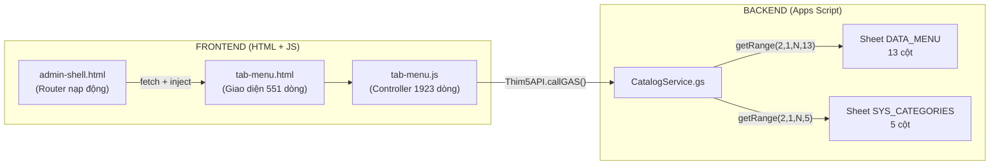
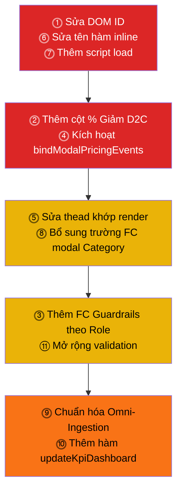

# 🛡️ KẾ HOẠCH KIỂM TOÁN ZERO-DEFECT — TAB-MENU.HTML
### Hệ thống: LongHoaFood Master Control Plane v3.5 SaaS
### Ngày lập: 14/10/2026 | Kiến trúc sư: Đu Đủ

---

> [!IMPORTANT]
> **Quy ước Plan**: Mỗi tiêu chí ghi rõ **[Hiện trạng]** → **[Kỳ vọng]** → **[Hành động sửa cụ thể]**.
> File chỉ dẫn chính xác vị trí dòng code, tên hàm, tên DOM ID để khi triển khai không phải tìm lại.
> **TUYỆT ĐỐI KHÔNG SỬA CODE** trong bản Plan này.

---

## SƠ ĐỒ KIẾN TRÚC DỮ LIỆU HIỆN TẠI



## BẢNG ÁNH XẠ 13 CỘT REVERSE-PRICING — Sheet DATA_MENU

| Cột # | Header Sheet | Key Backend (`CatalogService.gs`) | Key Frontend (`tab-menu.js`) | DOM ID Modal |
|:---:|---|---|---|---|
| 0 | Mã Món | `code` | `item.code` | `#dish-code` / `#modalDishCode` |
| 1 | Tên Món | `name` | `item.name` | `#dish-name` / `#modalDishName` |
| 2 | Nhóm Danh Mục | `category` | `item.category` | `#dish-category` / `#modalDishCategory` |
| 3 | Giá App (+25%) | `appPrice` | `item.appPrice` | `#dish-app-price` / `#modalDishAppPrice` |
| 4 | % Giảm D2C | `discountPercent` | `item.discountPercent` | *(thiếu trong HTML cũ)* / `#modalDishDiscountPercent` |
| 5 | Giá Bán Web D2C | `d2cPrice` | `item.d2cPrice` | `#dish-price` / `#modalDishD2cPrice` |
| 6 | Giá Vốn COGS | `cogs` | `item.cogs` | `#dish-cogs` / `#modalDishCogs` |
| 7 | Lợi Nhuận Ròng | `profit` | `item.profit` | `#dish-profit` / `#modalDishProfitDisplay` |
| 8 | Trạng Thái | `status` | `item.status` | `#dish-status` / `#modalDishStatus` |
| 9 | Mô Tả | `desc` | `item.description` | `#dish-desc` / `#modalDishDesc` |
| 10 | Link Ảnh CDN | `imageUrl` | `item.imageUrl` | `#dish-image` / `#modalDishImageUrl` |
| 11 | Súp / Bán Kèm | `boosterSoup` | `item.boosterSoup` | `#dish-booster-soup` / `#modalDishBoosterSoup` |
| 12 | Tag Chiến Lược | `role` | `item.role` | `#dish-role` / `#modalDishRole` |

---

## 11 TIÊU CHÍ KIỂM TOÁN ZERO-DEFECT

---

### ⓵ SCHEMA FIDELITY — Đồng bộ 13 Cột giữa HTML ↔ JS ↔ Backend

**[Hiện trạng — ❌ LỆCH 2 BỘ DOM ID]**

`tab-menu.html` (file cũ nạp qua `admin-shell.html`) sử dụng **bộ DOM ID cũ** (ví dụ `#dish-code`, `#dish-price`, `#dish-cogs`…), trong khi `tab-menu.js` (Controller mới v3.5) tham chiếu đến **bộ DOM ID mới** hoàn toàn khác (ví dụ `#modalDishCode`, `#modalDishD2cPrice`, `#modalDishCogs`…).

| Vùng lệch | HTML cũ (`tab-menu.html`) | JS mới (`tab-menu.js`) |
|---|---|---|
| Modal Dish - SKU | `#dish-code` (L228) | `#modalDishCode` (L689) |
| Modal Dish - Tên | `#dish-name` (L232) | `#modalDishName` (L690) |
| Modal Dish - Category | `#dish-category` (L240) | `#modalDishCategory` (L691) |
| Modal Dish - App Price | `#dish-app-price` (L277) | `#modalDishAppPrice` (L692) |
| Modal Dish - D2C Price | `#dish-price` (L273) | `#modalDishD2cPrice` (L694) |
| Modal Dish - COGS | `#dish-cogs` (L281) | `#modalDishCogs` (L695) |
| Modal Dish - Profit | `#dish-profit` (L285) | `#modalDishProfitDisplay` (L875) |
| Modal Dish - Role | `#dish-role` (L244) | `#modalDishRole` (L696) |
| Modal Dish - Status | `#dish-status` (L324) | `#modalDishStatus` (L697) |
| Modal Dish - Soup | `#dish-booster-soup` (L335) | `#modalDishBoosterSoup` (L698) |
| Modal Dish - Desc | `#dish-desc` (L347) | `#modalDishDesc` (L699) |
| Modal Dish - Image URL | `#dish-image` (L305) | `#modalDishImageUrl` (L700) |
| Modal Dish Title | `#modal-dish-title` (L211) | `#dishModalTitle` (L688) |
| Table Body | `#menu-table-body` (L157) | `#menuItemsTableBody` (L362) |
| Category Tabs | `#category-filter-tabs` (L123) | `#menuCategoryTabsContainer` (L195) |
| Search Input | `#tab-search-input` (L83) | `#menuSearchInput` (L51) |

**[Kỳ vọng]**: Tất cả DOM ID trong `tab-menu.html` PHẢI trùng 100% với ID mà `tab-menu.js` truy vấn qua `document.getElementById()`.

**[Hành động]**:
1. Đổi toàn bộ DOM ID trong `tab-menu.html` sang bộ ID mới mà `tab-menu.js` yêu cầu (cột "JS mới" ở bảng trên).
2. Hoặc thay thế toàn bộ phần HTML của modal `#modal-single-dish` bằng HTML mới tương thích Controller v3.5.
3. Thêm trường `#modalDishDiscountPercent` (% Giảm D2C) — hiện đang **thiếu hoàn toàn** trong HTML cũ.

---

### ⓶ MISSING COLUMN — Cột #4 "% Giảm D2C" bị thiếu trong Form Modal

**[Hiện trạng — ❌ THIẾU CỘT]**

Backend `CatalogService.gs` đọc/ghi cột index `[4]` là `discountPercent` (dòng 114, 297, 324, 686). Controller `tab-menu.js` tham chiếu `#modalDishDiscountPercent` (dòng 693, 766, 826, 839-848). Nhưng `tab-menu.html` **không có input nào** mang ID `modalDishDiscountPercent` hay `dish-discount`.

**[Kỳ vọng]**: Form Modal phải có input `<input type="number" id="modalDishDiscountPercent">` với giá trị mặc định = `20` (tương ứng chiết khấu 20% kênh D2C so với App).

**[Hành động]**:
- Thêm ô input `% Giảm D2C` vào hàng 3 (Cơ Cấu Giá Reverse-Pricing) giữa `Giá App` và `Giá D2C`, sử dụng `id="modalDishDiscountPercent"`.
- Gắn `oninput` để kích hoạt tính toán đồng bộ 2 chiều với `recalculatePricingModal()`.

---

### ⓷ FOOD COST GUARDRAILS — Ràng buộc Biên FC theo Vai Trò Chiến Lược

**[Hiện trạng — ⚠️ THIẾU RÀNG BUỘC THEO ROLE]**

Hệ thống hiện chỉ đối soát `actualFcPercent > maxAllowedFc` (trần FC của danh mục SYS_CATEGORIES, mặc định 38%). Tuy nhiên **chưa có** ràng buộc biên FC theo `role` chiến lược:

| Role Chiến Lược | Food Cost Cho Phép | Ý nghĩa |
|---|---|---|
| `TRAFFIC` (Món kéo khách) | **50% – 55%** | Lỗ có kiểm soát để kéo traffic, bù lại bằng cross-sell |
| `CORE` (Chủ lực) | **35% – 45%** | Cán cân dòng tiền chính, nền tảng lợi nhuận |
| `BOOSTER` / Topping | **≤ 20%** | Margin cao, đòn bẩy kéo AOV |

**[Kỳ vọng]**: 
- Khi chọn `dish-role = TRAFFIC`, FC từ 50-55% = ✅ xanh, > 55% = ⚠️ cảnh báo, < 50% = 💡 thông báo "Có thể hạ giá thêm để tăng sức kéo"
- Khi chọn `dish-role = CORE`, FC 35-45% = ✅ xanh, > 45% = 🔴 chặn đứng
- Khi chọn `dish-role = BOOSTER`, FC ≤ 20% = ✅ xanh, > 20% = 🟡 cảnh báo, > 30% = 🔴 chặn đứng

**[Hành động]**:
1. Trong `tab-menu.js` → hàm `recalculatePricingModal()` (L870): thêm logic đọc `selectRole.value` để xác định biên FC cho phép thay vì chỉ dùng `catMeta.maxFcPercent`.
2. Trong `tab-menu.html` → khu vực `#dish-margin-badge` (L265) và `#dish-foodcost-advice` (L293): render thông điệp cảnh báo động theo role.
3. Thêm `onchange` listener cho dropdown `#modalDishRole` để trigger `recalculatePricingModal()` mỗi khi đổi vai trò.

---

### ⓸ AUTO-CALC NET PROFIT — Tự Động Tính Lợi Nhuận Ròng Khi Nhập COGS & % Giảm D2C

**[Hiện trạng — ⚠️ LOGIC ĐÚNG NHƯNG DOM LỆCH]**

`tab-menu.js` đã có `recalculatePricingModal()` (L870-914) tính đúng:
```
LNR = D2C_Price - COGS
FC%  = (COGS / D2C_Price) × 100
```
Nhưng do **bất đồng DOM ID** (tiêu chí ⓵), hàm này **không thể hoạt động** vì `getElementById("modalDishCogs")` trả về `null`.

Ngoài ra, `tab-menu.html` cũ có `oninput` handler gọi `window.TabMenuController.calculateMarginGuard('COGS')` (L281) — hàm này **không tồn tại** trong `tab-menu.js` (Public API không export hàm `calculateMarginGuard`).

**[Kỳ vọng]**: Nhập COGS ↔ % Giảm D2C → Lợi Nhuận Ròng (LNR) và FC% tự động cập nhật realtime.

**[Hành động]**:
1. Sửa DOM ID trong HTML cho trùng khớp (tiêu chí ⓵).
2. Xóa các `oninput="window.TabMenuController.calculateMarginGuard(…)"` cũ (L273, 277, 281).
3. Đăng ký sự kiện `input` cho các trường giá qua `bindModalPricingEvents()` (L796) trong JS — hàm này đã có sẵn nhưng **chưa bao giờ được gọi**.
4. **Thêm lệnh gọi** `bindModalPricingEvents()` vào cuối hàm `openEditModal()` (sau L667) để kích hoạt bộ tính tài chính realtime.

---

### ⓹ HEADER-TABLE MISMATCH — Bảng Ma Trận Hiển Thị Thiếu/Dư Cột

**[Hiện trạng — ❌ 10 CỘT HEADER ≠ 12 CỘT RENDER]**

`tab-menu.html` khai báo **10 cột `<th>`** (L144-155):
```
[Món Ăn & PL] [Danh Mục] [Giá Vốn COGS] [LNR] [Giá D2C] [Giá App] [Food Cost] [Súp/BK] [TT Bếp] [Thao Tác]
```

Nhưng `tab-menu.js → renderMenuItemsTable()` (L361-482) render **12 cột `<td>`**:
```
[Ảnh+SKU+Tên] [Danh Mục] [Giá App+%Giảm] [Giá D2C] [COGS+FC%] [LNR+%LNR] [Role] [Toggle Status] [Thao Tác Edit/Clone/Delete]
```

**[Kỳ vọng]**: Số cột `<th>` ở `<thead>` phải bằng chính xác số cột `<td>` mà JS render ra.

**[Hành động]**:
1. Viết lại `<thead>` trong `tab-menu.html` (L143-156) với **9 cột header** khớp chính xác cấu trúc render của JS:
   ```
   [Món Ăn] [Danh Mục] [Giá App/Giảm] [Giá Web D2C] [COGS/FC%] [LNR] [Vai Trò] [Trạng Thái] [Thao Tác]
   ```
2. Cập nhật `colspan` trong loading-row (`L161`) và empty-row (`L169`) từ `10` → `9`.

---

### ⓺ DUAL-CONTROLLER CONFLICT — Xung Đột 2 Bộ Controller Song Song

**[Hiện trạng — ❌ XUNG ĐỘT]**

`tab-menu.html` gọi trực tiếp `window.TabMenuController.handleSearch()`, `window.TabMenuController.openDishModal()`, `window.TabMenuController.closeDishModal()`, `window.TabMenuController.handleSaveDish()`, `window.TabMenuController.calculateMarginGuard()` — nhưng **KHÔNG HÀM NÀO** trong số này tồn tại trong Public API của `tab-menu.js`:

| Hàm gọi trong HTML (cũ) | Hàm tương đương trong JS (mới) | Tồn tại? |
|---|---|:---:|
| `handleSearch(value)` | `applyFilterAndRender()` (qua `bindCoreEvents` ở L51) | ❌ Khác tên |
| `openDishModal(null)` | `openEditModal(null)` | ❌ Khác tên |
| `closeDishModal()` | `closeEditModal()` | ❌ Khác tên |
| `handleSaveDish(event)` | `saveDishForm()` | ❌ Khác tên |
| `calculateMarginGuard('D2C')` | `recalculatePricingModal()` | ❌ Khác tên |
| `openCategoriesModal()` | `openCategoryModal(null)` | ❌ Khác tên |
| `closeCategoriesModal()` | `closeCategoryModal()` | ❌ Khác tên |
| `handleSaveCategory(e)` | `saveCategoryForm()` | ❌ Khác tên |
| `filterByCategory('ALL', this)` | `setCategoryFilter('ALL')` | ❌ Khác tên |
| `openOmniIngestionModal()` | `switchSubTab('OMNI_INGESTION')` | ❌ Khác tên |
| `handleSingleImageUpload(this)` | `handleDishImageUpload(event)` | ❌ Khác tên |
| `handleExcelFileSelect(this)` | `handleExcelFileSelect(event)` | ⚠️ Tham số khác |

**[Kỳ vọng]**: Mọi `onclick`, `oninput`, `onsubmit`, `onchange` inline trong HTML phải gọi đúng tên hàm có trong Public API của `tab-menu.js`.

**[Hành động]**:
1. Thay thế toàn bộ inline handler trong `tab-menu.html` sang tên hàm đúng theo bảng mapping trên.
2. Hoặc (giải pháp bền vững hơn): Xóa toàn bộ inline handler, để `tab-menu.js` tự bind event qua `init()` → `bindCoreEvents()` bằng `addEventListener`.

---

### ⓻ INIT LIFECYCLE — tab-menu.html Không Có <script> Nạp Controller

**[Hiện trạng — ❌ THIẾU ENTRY POINT]**

`tab-menu.html` **không có thẻ `<script src="tab-menu.js">`** và cũng không gọi `TabMenuController.init()`. Trong khi đó, `admin-shell.html` → `injectTabContent()` (L834-847) chỉ tìm và gọi `.init()` cho các tab: `pl`, `shippers`, `config`, `campaign` — **không có case cho tab `menu`**.

> Điều này nghĩa là nếu `tab-menu.html` được nạp vào `admin-shell.html` qua router, Controller sẽ **KHÔNG BAO GIỜ khởi chạy**.

**[Kỳ vọng]**: Khi admin-shell nạp `tab-menu.html`, Controller phải được tải và `TabMenuController.init()` phải được gọi tự động.

**[Hành động]**:
1. **Trong `tab-menu.html`**: Thêm ở cuối file, trước `</div>` đóng workspace:
   ```html
   <script src="tab-menu.js?v=20261014"></script>
   <script>
     if (window.TabMenuController && typeof TabMenuController.init === 'function') {
       TabMenuController.init();
     }
   </script>
   ```
2. **Trong `admin-shell.html`** → hàm `injectTabContent()` (L834-847): Thêm case:
   ```javascript
   } else if (tabKey === "menu" && window.TabMenuController && typeof window.TabMenuController.init === "function") {
     window.TabMenuController.init();
   }
   ```
3. **Trong sidebar**: Thêm nút tab `data-tab="menu"` cho Menu Studio vào nav (hiện chỉ có link `<a href="menu-manager.html">` mở tab mới).

---

### ⓼ MODAL CATEGORY — HTML Cũ Thiếu Trường maxFcPercent (Trần FC)

**[Hiện trạng — ⚠️ THIẾU TRƯỜNG]**

`tab-menu.html` → Modal `#modal-tab-categories` (L367-424) chỉ có 3 trường: `Icon`, `Tên`, `Slug D2C`. Nhưng sheet `SYS_CATEGORIES` có **5 cột** (Mã, Icon, Tên, Slug, **Trần FC**), và `tab-menu.js` tham chiếu `#modalCatMaxFc` (L1379, L1393, L1432).

**[Kỳ vọng]**: Form danh mục phải có input `Trần Food Cost %` (id=`modalCatMaxFc`) và input `Mã danh mục` (id=`modalCatCode`).

**[Hành động]**:
1. Thêm ô input `Mã Danh Mục` (id=`modalCatCode`) — hiện HTML chỉ có hidden `#tab-cat-id`.
2. Thêm ô input `Trần FC %` (id=`modalCatMaxFc`, type=number, default=38).
3. Đổi tất cả DOM ID trong modal Category sang bộ ID mới: `#tab-cat-icon` → `#modalCatIcon`, `#tab-cat-name` → `#modalCatName`, `#tab-cat-slug` → `#modalCatSlug`.

---

### ⓽ OMNI-INGESTION MODAL — Thiếu Sub-Tab Channels & Preview DOM

**[Hiện trạng — ⚠️ HTML CŨ CÓ NHƯNG DOM ID LỆCH]**

`tab-menu.html` (L426-546) có modal Omni-Ingestion với 4 kênh nạp (Excel, OCR, Link, JSON). Tuy nhiên, `tab-menu.js` sử dụng mô hình **Sub-Workspace** (`switchSubTab()` L1575) thay vì Modal overlay, và tham chiếu DOM ID hoàn toàn khác:

| Mục đích | HTML cũ | JS mới |
|---|---|---|
| Bảng preview tbody | `#ingest-preview-tbody` (L535) | `#ingestionPreviewTableBody` (L1800) |
| Badge đếm | `#preview-total-count` (L515) | `#ingestionPreviewCountBadge` (L1801) |
| Nút xác nhận nạp | `#btn-confirm-ingest-all` (L539) | `#btnCommitBatchImport` (L1802) |
| Status Excel | *(không có)* | `#ingestionExcelStatus` (L1627) |
| Status OCR | *(không có)* | `#ingestionOcrStatus` (L1691) |
| Status URL | *(không có)* | `#ingestionUrlStatus` (L1749) |
| Input URL | `#input-public-url` (L495) | `#ingestionTargetUrl` (L1748) |

**[Hành động]**:
1. Đổi toàn bộ DOM ID trong section Omni-Ingestion sang bộ ID mới.
2. Thêm các element `<span>` status cho từng kênh nạp.
3. Cân nhắc chuyển từ overlay modal → sub-workspace panel (nhúng inline) để khớp kiến trúc `switchSubTab()`.

---

### ⓾ KPI DASHBOARD — 4 Thẻ KPI Không Được Cập Nhật Bởi Controller

**[Hiện trạng — ⚠️ TĨNH / KHÔNG REACTIVE]**

`tab-menu.html` (L12-72) hiển thị 4 thẻ KPI với DOM ID:
- `#kpi-active-items` (L19), `#kpi-total-items` (L20)
- `#kpi-avg-foodcost` (L35)
- `#kpi-booster-count` (L48)

Nhưng `tab-menu.js` **KHÔNG có code nào** ghi dữ liệu vào các ID `kpi-*` này. Toàn bộ KPI hiển thị giá trị cứng `0`.

**[Kỳ vọng]**: Sau khi `loadAdminCatalog()` nạp xong, KPI phải tự động cập nhật:
- **KPI 1**: Số món `ACTIVE` / Tổng số món
- **KPI 2**: FC trung bình = `AVG(cogs/d2cPrice)` toàn bộ món ACTIVE
- **KPI 3**: Đếm số món có `role = BOOSTER`
- **KPI 4**: Trần FC cứng `45%` hoặc lấy MAX từ SYS_CATEGORIES

**[Hành động]**:
1. Thêm hàm `updateKpiDashboard()` trong `tab-menu.js` được gọi sau `applyFilterAndRender()`.
2. Hàm này `getElementById` các DOM `kpi-*` và tính toán từ `state.rawItems`.
3. Đổi DOM ID nếu cần để thống nhất quy ước (ví dụ `#kpiActiveItems` thay vì `#kpi-active-items`).

---

### ⑪ FORM VALIDATION & UX GUARD — Bảo Vệ Dữ Liệu Đầu Vào Trước Khi Gửi API

**[Hiện trạng — ⚠️ CHƯA ĐẦY ĐỦ]**

`tab-menu.js → saveDishForm()` (L920-1036) chỉ validate 2 trường: `code` và `name`. Thiếu:
- ❌ Validate `d2cPrice > 0` (có thể lưu món giá 0đ → sập dòng tiền)
- ❌ Validate `cogs >= 0` (có thể nhập số âm)
- ❌ Validate `appPrice >= d2cPrice` (sàn không thể rẻ hơn D2C)
- ❌ Block submit nếu FC% vượt trần nghiêm trọng (theo role)
- ❌ Kiểm tra trùng lặp SKU khi tạo mới (hiện có thể overwrite vô tình)

**[Kỳ vọng]**: Form PHẢI chặn đứng submit nếu vi phạm ít nhất 1 trong các điều kiện:
1. `d2cPrice <= 0` → Alert: "Giá bán D2C phải lớn hơn 0"
2. `cogs < 0` → Alert: "Giá vốn không hợp lệ"
3. `appPrice < d2cPrice` → Alert: "Giá App sàn phải ≥ Giá D2C"
4. FC% > ngưỡng role (CORE > 45%, BOOSTER > 30%) → Confirm: "Cảnh báo dòng tiền! Có chắc muốn lưu?"
5. Nếu `isEdit = false` và `code` đã tồn tại trong `state.rawItems` → Confirm: "SKU đã tồn tại, bạn muốn ghi đè?"

**[Hành động]**:
1. Mở rộng validation block trong `saveDishForm()` (sau L949).
2. Thêm visual feedback: border đỏ cho input vi phạm, tooltip message.
3. Thêm HTML element `<div id="modalFormValidationErrors">` trong modal để hiển thị danh sách lỗi tập trung.

---

## BẢNG TỔNG HỢP 11 TIÊU CHÍ — MỨC ĐỘ NGHIÊM TRỌNG

| # | Tiêu chí | Mức độ | File cần sửa | Dòng code |
|:---:|---|:---:|---|---|
| ⓵ | Schema Fidelity (DOM ID Lệch) | 🔴 **Critical** | `tab-menu.html` | L83,123,157,211,228-347 |
| ⓶ | Missing Column (% Giảm D2C) | 🔴 **Critical** | `tab-menu.html` | Thêm mới sau L277 |
| ⓷ | Food Cost Guardrails (Biên FC/Role) | 🟡 **Major** | `tab-menu.js` | L870-914 |
| ⓸ | Auto-Calc Net Profit (DOM lệch) | 🔴 **Critical** | `tab-menu.html` + `.js` | HTML: L273,277,281; JS: L667 |
| ⓹ | Header-Table Mismatch (Cột TH≠TD) | 🟡 **Major** | `tab-menu.html` | L143-156, L161, L169 |
| ⓺ | Dual-Controller Conflict (Tên hàm) | 🔴 **Critical** | `tab-menu.html` | L84,94,102,110,127,215,221,306,353,356,382,403,468,505 |
| ⓻ | Init Lifecycle (Thiếu script load) | 🔴 **Critical** | `tab-menu.html` + `admin-shell.html` | HTML: cuối file; Shell: L834-847 |
| ⓼ | Modal Category (Thiếu trường FC) | 🟡 **Major** | `tab-menu.html` | L387-406 |
| ⓽ | Omni-Ingestion (DOM ID lệch) | 🟡 **Major** | `tab-menu.html` | L429-543 |
| ⓾ | KPI Dashboard (Không reactive) | 🟠 **Medium** | `tab-menu.js` | Thêm hàm mới |
| ⑪ | Form Validation (Chưa đủ) | 🟡 **Major** | `tab-menu.js` | L920-949 |

---

## THỨ TỰ TRIỂN KHAI ĐỀ XUẤT



> [!CAUTION]
> **Pha 1 (⓵ + ⓺ + ⓻)** là **tiên quyết bắt buộc** — nếu không sửa 3 tiêu chí này trước, toàn bộ tab-menu.html sẽ **hoàn toàn không hoạt động** khi được nạp vào admin-shell.html vì không có Controller nào được kích hoạt và mọi sự kiện đều trỏ vào hàm không tồn tại.

---

> [!TIP]
> Để triển khai nhanh, có thể **viết lại toàn bộ `tab-menu.html`** từ đầu cho đúng bộ DOM ID của `tab-menu.js` (v3.5), thay vì sửa từng ID — vì có đến **30+ điểm lệch** xuyên suốt 551 dòng.
